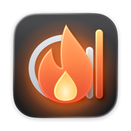
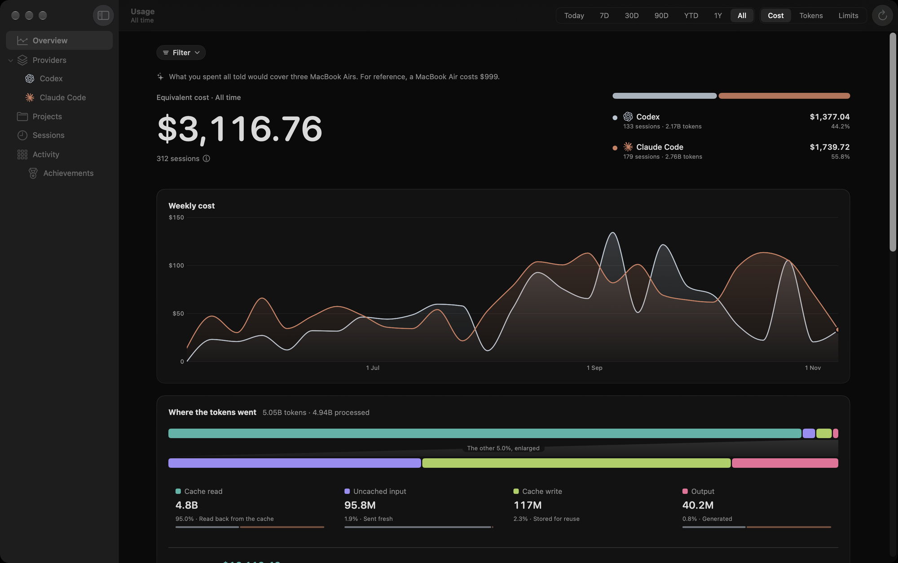
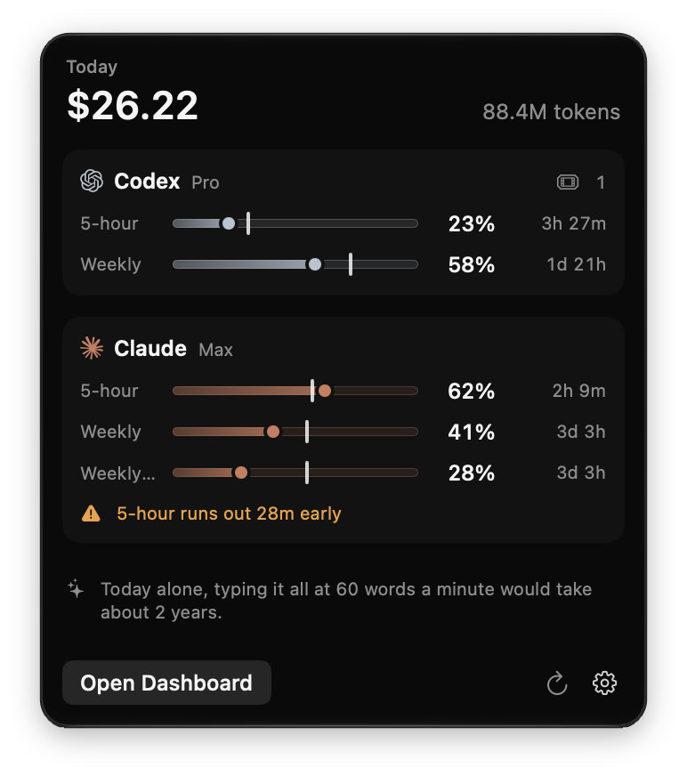
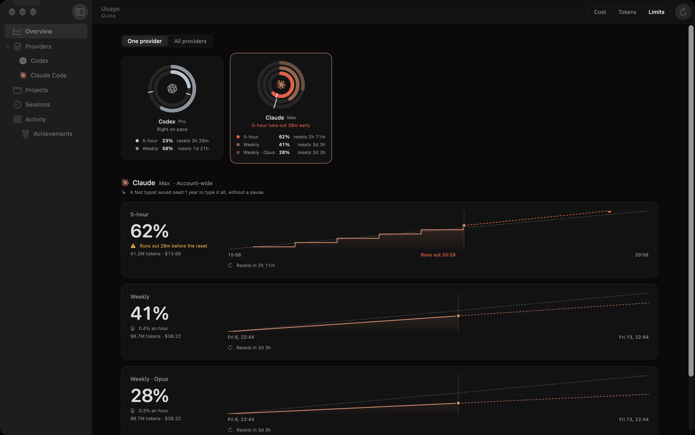
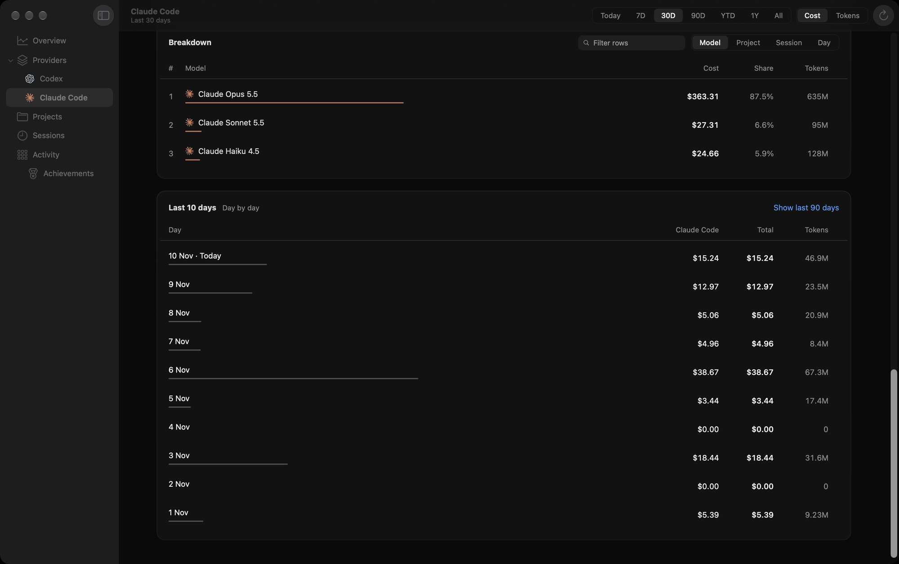
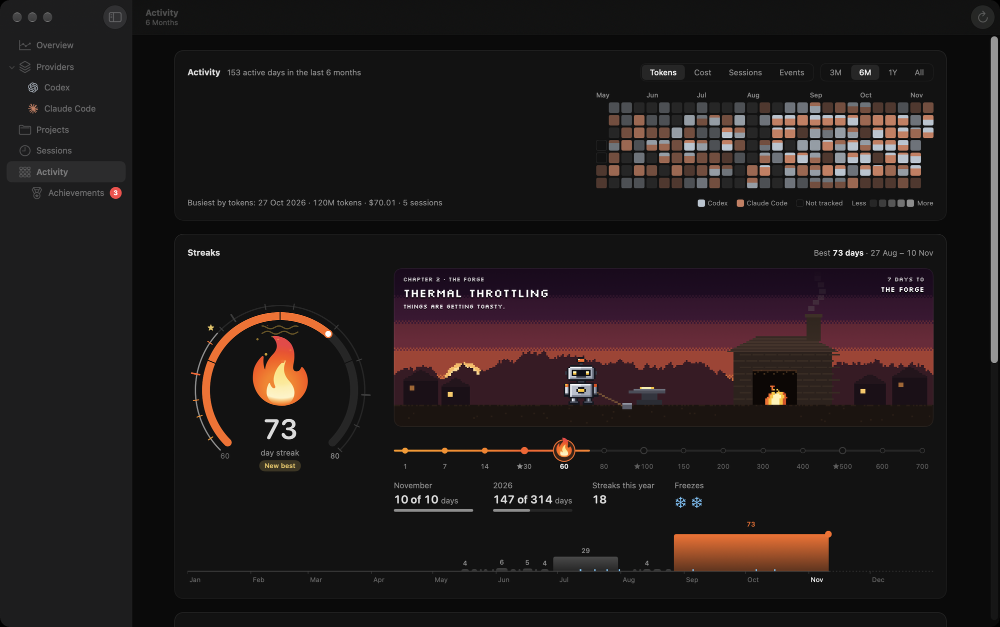
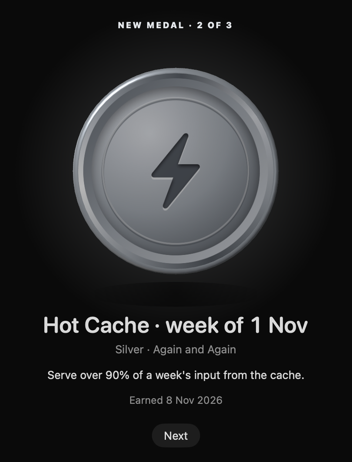
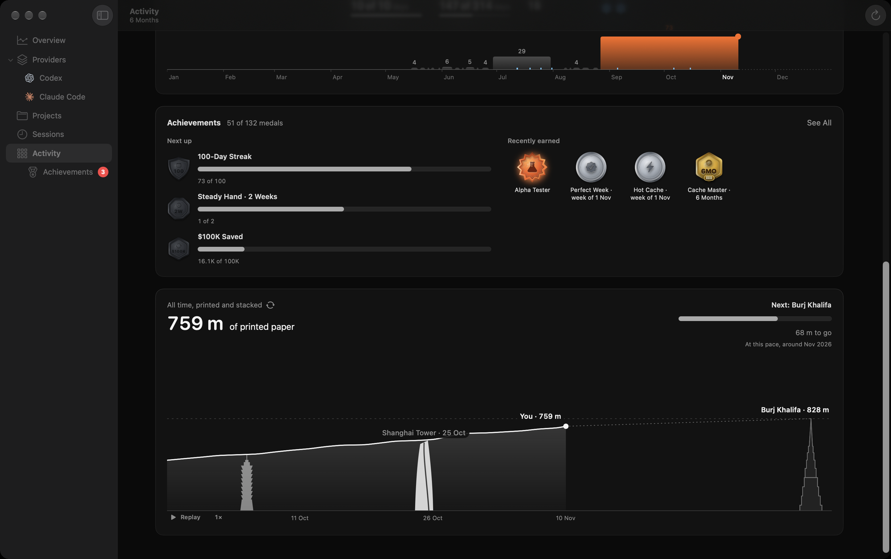

<p align="center">
  
</p>

<h1 align="center">Burnline</h1>

<p align="center">
  <b>See where your AI coding goes.</b><br>
  Usage, plan limits and what it would have cost, for <b>Claude Code</b> and <b>OpenAI Codex</b>,<br>
  in your Mac's menu bar and a dashboard that keeps every day you have ever coded.
</p>

<p align="center">
  <a href="https://github.com/igharsha7/Burnline-AI-Usage-Tracker/releases/latest"></a>
  <a href="https://github.com/igharsha7/Burnline-AI-Usage-Tracker/actions/workflows/ci.yml"></a>
  <a href="LICENSE"></a>
  
  
  
</p>

<p align="center">
  <a href="#install">Install</a> ·
  <a href="#features">Features</a> ·
  <a href="#privacy">Privacy</a> ·
  <a href="#coming-next">Coming next</a> ·
  <a href="docs/README.md">Docs</a> ·
  <a href="CONTRIBUTING.md">Contributing</a>
</p>

<p align="center">
  
</p>

https://github.com/user-attachments/assets/23203fec-bffa-4772-b79b-ac24273038b8

You ran an agent all afternoon. How much of your 5-hour window is left? Which
project ate the week? What would those months have cost at API prices? Is the
cache actually saving you anything?

The answers are already on your Mac, scattered across session files, `/status`
and billing pages. Burnline reads them, keeps them, and puts them where you
look anyway: a small flame in the menu bar that burns brighter the harder you
work.

It is **local-first**: no account, no server, no telemetry. It reads the files
Claude Code and Codex already keep, stores usage metadata only (never prompts,
replies or code), and works offline.

## Features

<table>
  <tr>
    <td width="42%"></td>
    <td>
      <h3>Today, at a glance</h3>
      A flame and today's cost sit in the menu bar. Click for the popover:
      every limit with its reset countdown, a warning when your current pace
      runs a window out before it resets, banked resets you are holding, and
      a line to put the day in perspective.
    </td>
  </tr>
</table>

### Every limit, and whether you'll hit it



Each 5-hour and weekly window, how fast it is filling, and where it is headed.
Burnline projects your burn rate forward ("5-hour runs out 28m early"),
remembers how earlier windows went, and keeps Codex's banked resets with their
expiry dates. Figures it could not refresh are marked stale, never passed off
as current.

### What it would have cost, exactly



Every request is priced at the API rate **in force when it happened**, from a
versioned price history that updates daily. Money is kept in whole
nanodollars, so totals never drift. Break any range down by provider, model,
project, session or day, from today to all time, and see how much caching
saved.

### Streaks, and a reason to keep them



A heatmap of every day you coded, and a streak that tells a story as it
grows: from a campfire to the forge, a launch, the sun and beyond. Freezes
cover the days you take off.

<table>
  <tr>
    <td width="40%"></td>
    <td>
      <h3>Medals worth earning</h3>
      132 medals across volume, landmarks, habits and monthly challenges,
      from bronze to diamond, and ember for the rarest. Some are for working hard;
      some are for working smart, like keeping your cache hot or staying
      under your limits.
    </td>
  </tr>
</table>

### Numbers you can feel



What does five billion tokens look like? Burnline answers in things you know:
printed paper stacked past skyscrapers, novels, groceries, MacBooks. Pick the
tone in Settings, **dry**, **nerd** or **roast**, or turn comparisons off.

### And the rest

- **Notifications** for thresholds, limits reached, resets, banked resets about
  to expire, spend and milestones, each sent once and only for fresh figures.
- **Years of history, kept small.** Old detail is compacted into 15-minute
  totals without changing a single figure; a heavy user stays in the hundreds of
  megabytes.
- **Backups, export and restore**, and a database any SQLite tool can open.
- **Light on your Mac.** No polling while idle, no animation off screen, and
  CI turns away any change that makes it measurably slower.

## Install

Burnline needs **macOS 14 or later**.

**Download** the `.dmg` from the
[latest release](https://github.com/igharsha7/Burnline-AI-Usage-Tracker/releases/latest),
open it, and drag Burnline into Applications.

**Or with Homebrew:**

```sh
brew tap igharsha7/tap
brew trust --cask igharsha7/tap/burnline
brew install --cask igharsha7/tap/burnline
```

Homebrew 7 loads a cask from someone else's tap only once you trust it, which
is what the middle line does, for Burnline's cask alone. On older Homebrew,
skip it.

Either way, macOS asks once the first time Burnline opens; the steps are just
below. On first launch, pick the tools to track: Burnline imports their
history and settles into the menu bar. It tracks whichever of **Claude Code**
and **Codex** you use, one or both. With neither, it opens to an empty
dashboard that fills in once you start. It can drop its Dock icon in
Settings.

**Updates.** Burnline checks once a day and shows an **Update** button when a
new version is out; nothing installs until you choose it. Want new work
first? Switch to the **Nightly** channel in Settings → General → Updates.
Nightlies are pre-releases, built from the newest work. See
[updates](docs/updates.md).

**Build from source** (Xcode 26 or later):

```sh
git clone https://github.com/igharsha7/Burnline-AI-Usage-Tracker.git
cd Burnline-AI-Usage-Tracker
open macos/Burnline.xcodeproj
```

Choose the **Burnline** scheme and press Run. [Development](docs/development.md#running-a-debug-build-safely)
covers running a build safely alongside an installed copy.

### Opening it the first time

**A downloaded Burnline asks for permission once.** It is the same for the
`.dmg` and for Homebrew:

1. **Drag Burnline into Applications** (Homebrew does this for you) and open
   it from there.
2. **macOS says it cannot verify the developer. Choose Done**, not Move to
   Trash.
3. **Open System Settings → Privacy & Security** and scroll down to the
   Security section.
4. **Choose Open Anyway beside the message about Burnline**, then confirm
   with your password or Touch ID.

That's it. Burnline opens, and it never asks again: updates installed from
within Burnline open straight away.

**Why does macOS ask?** Apple only lets an app open without asking once it is
*notarized*: signed by a member of the Apple Developer Program and scanned by
Apple. Membership costs $99 a year. Burnline is free, open source and has no
backend that earns anything, so we'd end up asking you to fund us so we could
pay Apple to stop warning you about us. One click in Settings seemed the
better deal. The app is still signed with the same certificate in every
release, so macOS can tell an update came from the same place, and each
release lists its SHA-256 so you can check your download. Since macOS 15, the
old Control-click → Open shortcut no longer works for apps like this, so
Settings is the way. More in
[releasing](docs/releasing.md#opening-an-un-notarized-app).

## Privacy

Burnline reads Claude Code's and Codex's local history, the git remotes of the
folders you worked in, and your quota. It is not sandboxed, because it has to
read `~/.claude` and `~/.codex`. It makes exactly these network requests:

- a daily download of the public price list from this repository (can be
  turned off);
- a daily check of the public list of updates, and the download of one you
  choose to install (can be turned off);
- Claude's usage endpoint, with Claude Code's own login, for Claude's limits;
- whatever Codex's own tool sends when asked for its limits.

Nothing else, and nothing about you or your usage ever leaves your Mac.
Details in [privacy and security](docs/privacy-and-security.md).

## Coming next

- **v0.2.0**: **OpenCode** and **Antigravity**.
- **Windows**: in progress, built on the same database format.

Want another tool supported? [Open an issue](https://github.com/igharsha7/Burnline-AI-Usage-Tracker/issues/new/choose),
or read [adding a provider](docs/adding-a-provider.md).

## How it's built

Swift 6 and SwiftUI, with AppKit where needed, Swift Charts, and SQLite
through GRDB. Five modules with a dependency rule the tests enforce, over 700
tests, a coverage floor that only rises, and a performance gate on every pull
request. [The documentation](docs/README.md) covers it all, from the
[architecture](docs/architecture.md) and [data model](docs/data-model.md) to
every [edge case](docs/edge-cases.md) it handles.

## Contributing

Bug reports, ideas and pull requests are welcome. Start with
[CONTRIBUTING](CONTRIBUTING.md); features need an approved issue first.

If Burnline helps you, **star the repository**. It is the easiest way to help
other people find it.

## License

Copyright (C) 2026 Challapalli Harshavardhan Reddy.

Burnline is free software under the **GNU Affero General Public License
v3**, with an additional attribution term under Section 7(b): any
redistribution must preserve the original author attribution. See
[LICENSE](LICENSE), [NOTICE](NOTICE) and [licensing](docs/licensing.md).

Claude is a trademark of Anthropic, PBC, and OpenAI is a trademark of OpenAI.
Burnline is not affiliated with or endorsed by either.
