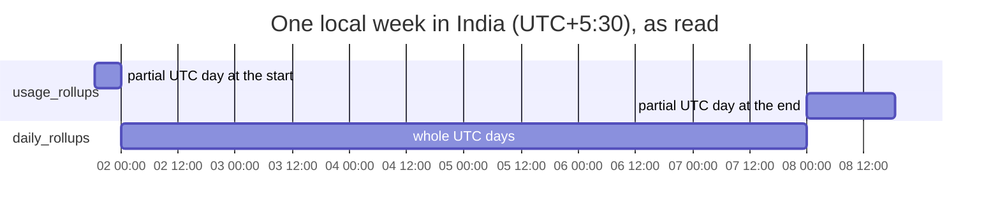

# Aggregation

How charts, headline figures and tables are computed: ranges, bucket widths,
the calendar, and the three tiers of stored sums that keep years of history
interactive.

## One entry point

Views never issue SQL. `AggregationService` (Services) is the one place that
answers "how much":

| Call | Returns | Used by |
|---|---|---|
| `aggregate(range, width:, grouping:, filters:)` | `UsageSeries`: every bucket of the range, empty ones included, with totals per group | the usage chart, the ledger, the heatmap |
| `summary(range, filters:)` | `UsageSummary`: totals, sessions, active days | the hero figure and headline numbers |
| `breakdown(range, by:, filters:)` | `[BreakdownRow]`, largest cost first | the breakdown table, Projects, Sessions |
| `sessions(range, filters:)` | how many sessions | session counts |
| `previous(range)` | the preset for the period before, up to the same point | the change against the previous period |
| `window(for:)`, `lastDays(_:)` | a preset resolved to a time window; a preset of the last *n* days | pages and the ledger |
| `trackingStart()` | when tracking began | "Not tracked yet" spans (EC-U2) |
| `busySpanCosts(in:span:)` | the cost of each busy stretch | the menu bar's heat scale |

Every result is built from `UsageTotals`: every token type, cost, cache
savings, and the count of unpriced events. **The view chooses the metric**,
and coverage is computed from the data, never assumed (EC-U3).

`Grouping` is total, provider, model or project. `BreakdownKey` adds session.

## Ranges

`RangePreset`, resolved on the user's `LocalCalendar` to whole local days
ending with today:

| Preset | Toolbar | Span |
|---|---|---|
| `today` | Today | today |
| `last7Days` | 7D | the last 7 days, today included |
| `last30Days` | 30D | 30 days |
| `last90Days` | 90D | 90 days |
| `yearToDate` | YTD | from 1 January |
| `lastYear` | 1Y | the last 365 days |
| `all` | All | from the day of the oldest usage, compacted history included |
| `custom(window)` | — | a drilled-in bucket or a chosen span |

The chosen range is kept between launches (`dashboardRange`); a drilled range
is not.

**The previous period** is compared up to the same point in it. For a range
still running, today until now is compared with yesterday until this time,
never with all of yesterday. A window of whole local days steps back that many
days at the same clock time, so a 25-hour day before a daylight-saving change
does not pull in an hour of the wrong day (EC-T1). All time has no previous
period.

## Bucket widths

`BucketWidth.automatic(for:)` keeps a chart between a few dozen and a few
hundred points:

| Range length | Width |
|---|---|
| up to 6 hours | minute |
| up to 48 hours | hour |
| up to 90 days | day |
| up to two years | week |
| longer | month |

Quarter-hour buckets exist too, for internal use.

**Hours and longer come from the calendar, never from dividing epoch seconds**
(EC-T1):

- a spring-forward day is 23 hours, and a fall-back day has 25 hour buckets;
- an hour in India starts at half past the UTC hour;
- a date a zone skipped entirely (Samoa skipped 30 December 2011) has an empty
  window and is never listed as a day;
- weeks start on the configured weekday (EC-T4) and are built by walking day
  boundaries, because around a skipped date Foundation returns a week interval
  that does not contain the instant at all;
- day arithmetic anchors on noon, because midnight does not exist in zones that
  change their clocks at 00:00.

A time-zone or week-start change takes effect by building a new
`LocalCalendar`; stored timestamps never change (EC-T2). The week start
setting applies at the next launch, since every range is built on it.

A first or last bucket can reach outside the range (a day bucket for a range
that starts at noon). It is labelled as the whole calendar bucket but counts
only the part inside the range, so **a series always sums to its range's
summary**.

## Bucketing happens in SQL

Swift works out the bucket edges on the calendar and passes them as one JSON
list. The query joins the list against an index, so nothing is grouped in
Swift and a 23-hour day is exact:

```sql
WITH edges(i, lo, hi) AS MATERIALIZED (
  SELECT json_extract(value, '$[0]'), json_extract(value, '$[1]'), json_extract(value, '$[2]')
  FROM json_each(:edges))
SELECT edges.i, r.provider_id, sum(r.events), sum(r.output_tokens), sum(r.cost_nanos),
       sum(r.unpriced_events), …
FROM edges JOIN usage_rollups r ON r.bucket >= edges.lo AND r.bucket < edges.hi
GROUP BY edges.i, r.provider_id;
```

This is simplified: the real query reads the daily and 15-minute tiers
together (below). The edge list is materialised so it is parsed once.

## Three tiers

| Tier | Rows | Answers | Reaches back |
|---|---|---|---|
| `usage_events` | one per response | minute buckets, sessions, the model filter on session counts, exact edges | the detail window only |
| `usage_rollups` | per 15 min, provider, model, project | everything at a quarter hour or coarser | all of history |
| `daily_rollups` | per UTC day, provider, model, project | the whole UTC days inside a range | all of history |

Every time zone's offset is a multiple of 15 minutes, so local hours, days,
weeks and months fall on rollup edges, and the rollups answer any calendar
range exactly, compacted history included.

**The daily split.** A local day is not a UTC day. Each bucket is split
(`AggregationRepository.dailySplit`): its whole UTC days come from
`daily_rollups`, and the partial days at either end, or a bucket shorter than a
day, from `usage_rollups`.



A long range then reads about a tenth of the rows, and stays exact to the
quarter hour. The result is identical to summing `usage_rollups`
alone; tests check it for local days, weeks and months, and against a migrated
copy of a real database.

**Edges inside a quarter hour.** Rollups hold whole quarter hours and would
round an end that falls inside one up to the quarter's end, counting usage
after it. A window read from rollups therefore takes its whole quarters from
them and any part-quarter at an edge from events, exact to the second. An edge
in compacted history, whose events are gone, is left out rather than
overcounted.

**Minute charts** read events through `idx_usage_ts`. A minute chart reaching
before the compaction boundary falls back to quarter hours.

## Filters

`UsageFilters` holds sets of providers, models, projects and sessions; an
empty set means no filter on that dimension. They are applied in SQL as
`IN (SELECT value FROM json_each(?))`.

- **Projects follow merges.** A project filter or grouping resolves each
  project to the one it was merged into, through any chain, with a recursive
  query (`projectRoots`). It is joined only when a query involves projects. So
  merged projects count under the project they joined, and filtering by a
  project includes everything merged into it.
- **Session filters read events**, since rollups do not know their session,
  and so reach no further back than the detail window.
- **Session counts ignore the model filter** in the summary: a session has no
  single model. Under a model filter, the count is of sessions that used one of
  those models, which only events know, so compacted history counts none.

The global filters (provider, model, project) are kept between launches
(`dashboardFilters`) and always shown as chips on every page, so a figure
never changes without its reason on screen.

## The breakdown

`breakdown` returns one row per group over the range, largest cost first,
named for display. A row carries the provider a model or session belongs to
(nil for a project, which can span several), whether it is a real model (a
non-model is shown but left out of model shares), and its totals. A row whose
history is compacted is exact to the quarter hour.

Sessions are listed only within the detail window.

## Activity reads

`ActivityService` reads every tracked day at once, from the rollups so
compacted history counts: each day's active quarter hours, sessions, tokens,
cost and events; each day's tokens by project (merged projects under the one
they joined); the models used each day; and when each model and project was
first used. These feed the heatmap, streaks and achievements. See
[activity and achievements](activity-and-achievements.md).

## Status reads

`StatusService` reads what the menu bar needs, off the main actor:

- today's totals, equivalent cost and its coverage, and when the day ends, so
  figures start over at midnight without waiting for usage;
- **live activity**: a provider is live while its last event is under 2
  minutes old. Its pace is measured over the last 5 minutes. Sessions active
  in that window are listed, busiest first, each with its cost an hour.
- **new tokens a minute**, which leaves out cache reads. An agent re-reads its
  whole conversation from cache on every reply, so the processed rate runs a
  hundred times what is actually new.
- **the heat scale**: the cost of every 5-minute stretch with priced usage in
  the last 30 days (`busySpanCosts`), read from events. See
  [the interface](interface.md#heat).
- what this Mac sent a provider since a quota window began, for the Limits
  page.

## Budget

The interactive budget is **100 ms, warm**, for a range preset's chart and
its breakdown together. Measured figures are in
[performance](performance.md#aggregation).
