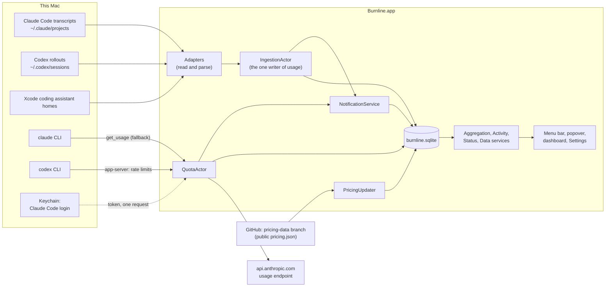
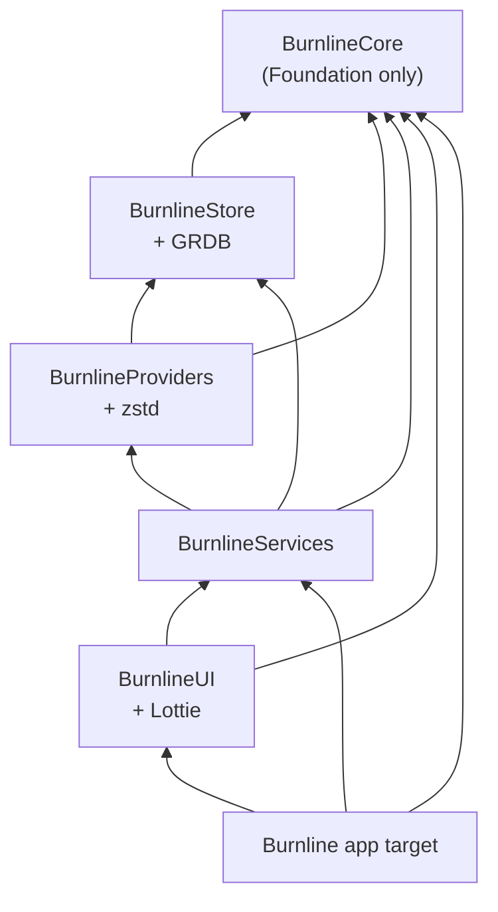
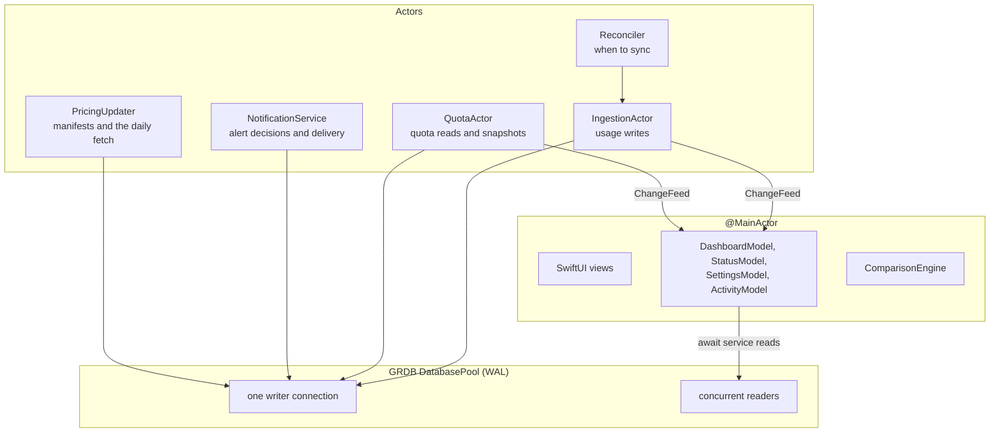
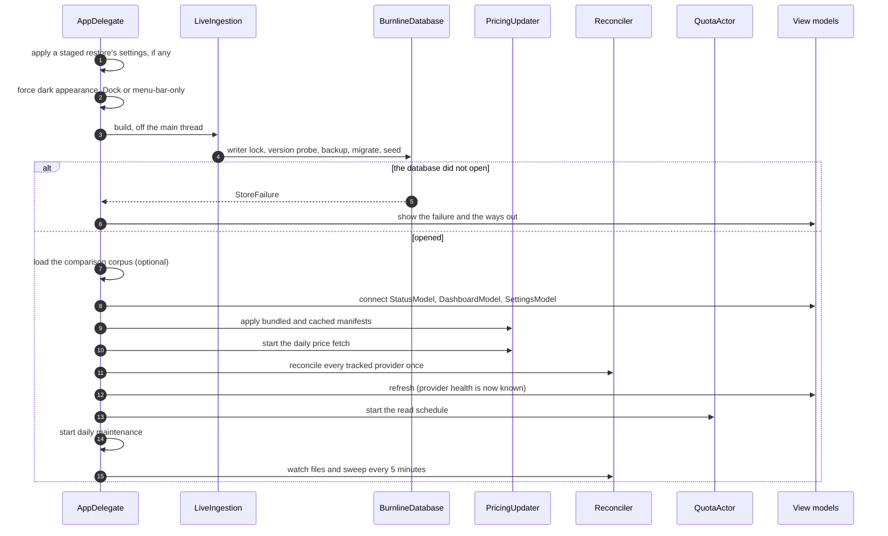

# Architecture

How the macOS app is put together: the pieces, how data moves between them,
which code may depend on which, and where each kind of work runs.

Read [the contracts](contracts.md) alongside this. The contracts say what any
Burnline must do, on any platform. This document says how the macOS app does
it. Where the two disagree, the contracts win, and the disagreement is a bug.

## The system in one picture



Everything inside the app box runs locally. The three arrows that leave the
Mac are the only network traffic Burnline causes. Two of them are made by the
providers' own command-line tools when Burnline asks them for quota.
[Privacy and security](privacy-and-security.md#network) lists every request.

## Repository layout

```
.
├── shared/                    language-neutral; every platform ships these
│   ├── schema/                NNN_name.sql migrations: the database itself
│   ├── pricing/               pricing.json, model_aliases.json, tools/ (the generator)
│   └── corpus/                comparisons.json
├── macos/
│   ├── Burnline.xcodeproj     the app target
│   ├── Burnline/              app sources (a synchronised folder), icon, acknowledgements
│   ├── Packages/              one Swift package: five library modules and their tests
│   ├── scripts/               license-header check, icon generator
│   └── design/                how the icon is made
├── docs/                      these documents
├── .github/workflows/         CI, its pull-request report, the daily pricing job
├── LICENSE, NOTICE            AGPL-3.0 and its Section 7(b) attribution term
└── THIRD-PARTY-NOTICES        licenses of bundled dependencies and assets
```

The Windows implementation, in progress, will be a `windows/` directory beside
`macos/`, never a branch. Branches model work that converges; two platforms
never converge, and two long-lived branches would mean every shared fix is
cherry-picked twice.

## Modules

One local Swift package, `macos/Packages`, holds five library modules. Using
one package with five targets, rather than five packages, means a single
`swift test --package-path macos/Packages` builds and tests everything with no
Xcode and no running app.

| Module | Holds | Must not |
|---|---|---|
| **BurnlineCore** | Domain types and pure logic: money, time and calendars, events, pricing selection (`Pricer`), quota, reset detection, burn rate, alert decisions (`AlertPlanner`), streaks, achievements, heat | import anything but Foundation; do I/O; read the clock outside `Time/` |
| **BurnlineStore** | GRDB, opening and migrating the database, repositories, compaction, backup, deletion, repair, the manifests' loaders | know about providers or the UI |
| **BurnlineProviders** | Provider adapters, file reading (lines, zstd), project identity from `.git`, quota readers, Claude Code's credentials | write to the database |
| **BurnlineServices** | Orchestration: ingestion, file watching, reconciling, maintenance, quota scheduling, notifications, pricing updates, aggregation, activity, comparisons, data controls. **The only layer that owns timers.** | contain SwiftUI |
| **BurnlineUI** | SwiftUI views, view models (`DashboardModel`, `StatusModel`, `SettingsModel`), design tokens, bundled fonts, logos and the fire animation | import BurnlineStore |

The app target, `macos/Burnline/`, is the composition root: `BurnlineApp.swift`
declares the scenes and an `AppDelegate` assembles the services at launch. It
imports Core, Services and UI, and never Store.

A sixth target, `BurnlineTestSupport`, gives tests scratch directories that
delete themselves. No product exposes it, so it never reaches the app.

### The dependency rule



An arrow means "may import". Two consequences matter most:

- **Views cannot issue SQL.** UI has no route to Store. Everything a view shows
  comes through a service, which is what keeps queries, their performance
  budgets and their correctness rules in one place.
- **Adapters cannot reach the UI**, and nothing above Providers knows a
  provider's file format.

The rule is in `Package.swift` as target dependencies, and `ArchitectureTests`
checks it again by reading the source tree. The test exists because the
compiler alone does not reliably reject an undeclared import between targets
of one package, so a stray `import BurnlineStore` in a UI file could build. See
[testing](testing.md#fitness-tests).

## Concurrency

Swift 6 language mode with strict concurrency. Approachable Concurrency
(`NonisolatedNonsendingByDefault`, `InferIsolatedConformances`) is on in every
module. **Main-actor default isolation is on only in BurnlineUI and the app
target.** Libraries ship nonisolated API and let the caller decide where work
runs. In the Xcode project the same settings are
`SWIFT_APPROACHABLE_CONCURRENCY` and `SWIFT_DEFAULT_ACTOR_ISOLATION`.



| Domain | What runs there | Why |
|---|---|---|
| `@MainActor` | Views, view models, `ComparisonEngine` | UI, and string formatting that never contends. An actor would only add `await` to trivial calls. |
| `IngestionActor` | Parsing, resolving identities, writing events | One writer of usage: writes never interleave, and a write failure has one place to be handled. |
| `Reconciler` | Deciding when to sync, provider health | Serialises syncs per provider. |
| `QuotaActor` | Quota reads, reset detection, burn rate, snapshots | Isolates network and child-process failure from ingestion. |
| `NotificationService` | Alert decisions, deduplication, delivery, achievement judging | One place keeps what was already sent. |
| `PricingUpdater` | Applying manifests, the daily fetch, repricing | Pricing changes are rare and must not race each other. |

Rules that follow:

- Every Core type is `Sendable`. Public types state it explicitly; it is never
  inferred across a module boundary.
- **Usage events are written only by `IngestionActor`.** `QuotaActor` writes
  only quota snapshots, banked resets and pending resets.
  `NotificationService` writes only `notification_events` and achievements'
  announcement marks. `ActivityService` stores newly earned achievements and
  never rewrites one. `PricingUpdater` writes only pricing versions and the
  repricing they cause. `DataService`'s deletion and repair, which the user
  starts from Settings, work in short batches so ingestion keeps writing
  between them. All of these go through the pool's single writer connection,
  so SQLite serialises them.
- Parsing runs across cores inside an ingestion pass: several files are parsed
  at once, blocking the actor so another sync of the same files cannot start
  midway, then written in order.
- Views never poll. Ingestion and quota push to `ChangeFeed`, and each view
  model subscribes and reloads. Bursts of changes are folded into one reload
  (`Coalescer`).
- **Time is injected.** `WallClock` is the only way to read the current time,
  and `Date()` may appear only in `BurnlineCore/Time/`. Randomness is injected
  the same way. Both rules are fitness tests.
- Long-running loops are `async` functions run inside a `Task` the app holds,
  ended by cancelling it.

## Launch



Details worth knowing:

- The menu bar and dashboard are built empty and show a loading state until
  they are connected, so the scenes can appear immediately.
- Prices are applied **before** the first sync, so new events are priced as
  they arrive.
- **On wake** (`NSWorkspace.didWakeNotification`), history is synced first,
  to catch file events missed while asleep (EC-I10), then every provider's
  quota is read before any reset is judged (EC-T5).
- **At quit**, maintenance runs `PRAGMA optimize`. Closing the dashboard does
  not quit the app; the menu-bar item stays.
- If the comparison corpus fails to load, comparisons are switched off and
  everything else runs.

## How a figure reaches the screen

1. A provider's tool appends a line to a transcript.
2. FSEvents reports a change under that provider's home within about a second
   (`FileWatcher`).
3. `Reconciler` asks `IngestionActor` to sync that provider. Each file is
   stat-ed and compared with its saved state. Only the new tail of the changed
   file is read. See [ingestion](ingestion.md).
4. The adapter parses the new lines into `IncomingUsage`.
5. `IngestionActor` writes the batch in one transaction: identities, events,
   their prices, parser errors and the new file offset. Triggers update
   `usage_rollups`, and those triggers update `daily_rollups`.
6. `Reconciler` publishes a change on `ChangeFeed`, and tells `QuotaActor`
   the provider is in use, so its quota is read more often.
7. `StatusModel` and the visible page's `ScopeModel` reload through
   `StatusService` and `AggregationService`, which read the rollups.
8. `NotificationService` checks milestones, spend alerts and achievements.

## Where state lives

| State | Where | Notes |
|---|---|---|
| Usage, quota history, prices, projects, sessions, achievements, sent alerts | `~/Library/Application Support/Burnline/burnline.sqlite` | One SQLite file in WAL mode, plus `-wal` and `-shm`. See [the data model](data-model.md). |
| Pre-migration backups | `…/Burnline/Backups/` | The newest three are kept. |
| Writer lock | `…/Burnline/burnline.sqlite.lock` | An `flock`; the kernel releases it if the app dies. |
| Last fetched price list | `…/Burnline/pricing.json` | Its file date is when it was fetched. |
| A staged restore | `…/Burnline/burnline.pending-restore.sqlite`, `burnline.pending-settings.plist` | Swapped in at the next launch. |
| Preferences | the app's `UserDefaults` | Keys are listed in [the interface document](interface.md#preferences). No secret is ever stored there. |

A debug build can be pointed at a scratch store and a scratch preferences
domain; see [development](development.md#running-a-debug-build-safely).

## Dependencies

| Package | Version | License | Used for |
|---|---|---|---|
| [GRDB.swift](https://github.com/groue/GRDB.swift) | from 7.11.1 | MIT | SQLite access in BurnlineStore |
| [zstd](https://github.com/facebook/zstd) | exactly 1.5.7 | BSD-3-Clause (dual with GPLv2, used under BSD) | Codex's compressed session archives |
| [lottie-spm](https://github.com/airbnb/lottie-spm) | from 4.6.1 | Apache-2.0 | Playing the Streaks card's fire animation |

zstd is pinned exactly because it is C built from source. Bundled assets (the
provider marks, the Silkscreen font, the Noto fire animation) have licenses of
their own; see [licensing](licensing.md#third-party-material). Every new
dependency must be AGPL-compatible and justified in its commit.
