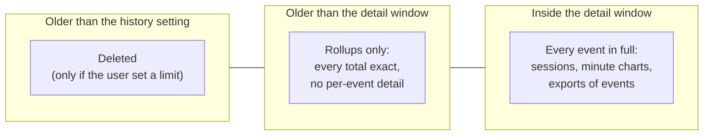
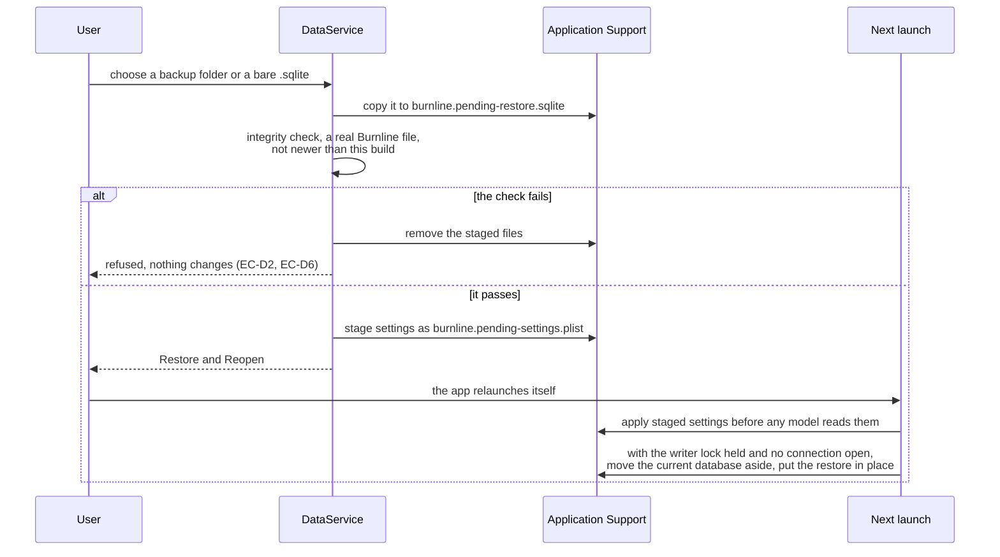

# Data lifecycle

How Burnline keeps a lifetime of history small, and everything the user can
do with it: retention, compaction, maintenance, backup and restore, deletion,
repair, export and diagnostics. All of it works on **Burnline's own copy**.
Provider files are only ever read.

## Lifetime by default

Providers delete their own history (Claude Code after 30 days by default), so
Burnline's database becomes the only record of older usage. Every token count
and cost is therefore kept **forever** unless the user chooses otherwise.

Two settings in Settings → Data govern how:

| Setting | Preference | Choices | Effect |
|---|---|---|---|
| **Keep full detail for** (`DetailRetention`) | `detailRetentionDays` | 90 days, **180 days** (default), 1 year, forever | Older events are **compacted**: every total, chart and cost stays exact; per-event detail goes |
| **Keep history for** (`HistoryRetention`) | `historyRetentionYears` | 1, 2 or 5 years, **forever** (default) | Older usage is **deleted**, totals included |

## Compaction

`StoreMaintenance` runs once a day, and at once when the detail window is
shortened. It calls `BurnlineDatabase.compact(before:)` with the start of the
window:

1. The cutoff is rounded down to a whole 15-minute bucket, so no bucket is
   ever part compacted.
2. **The boundary moves first, and only forward.** `compaction.compacted_before`
   is advanced before any event is deleted, so ingestion stops accepting older
   events first. A crash midway leaves events whose rollups are already safe,
   and the next pass finishes them.
3. **The boundary never moves past history that exists.** It goes only as far
   as the end of the bucket holding the newest stored event before the cutoff.
   It marks history that is in the rollups, not time nothing was imported for.
   On a new store it stays put, so a first import keeps everything older than
   the window, and a later pass compacts it (EC-D7).
4. Events before the boundary are deleted in batches of 10,000. The rollup
   delete trigger does not fire for them, so their sums stay (EC-D10).
5. Freed pages return to the disk. If the compaction removed **a quarter or
   more** of the stored events, as the first compaction of a long history
   does, one `VACUUM` rewrites the file packed tight. Deleting events leaves
   the dedup index's pages part empty (its keys are random), which only a
   `VACUUM` repacks. Daily passes remove a day's worth and never reach the
   threshold.

**What compaction loses:** per-event detail, such as a session's individual
replies, minute-level charts, the session filter, and per-event export. **What
it keeps:** every token type, cost, cache savings, unpriced count, chart at a
quarter hour or coarser, project, session row and first-use date.

**Late history.** An event before the boundary is inserted only into a
15-minute bucket holding none of its provider's compacted history (EC-D11).
There, the rollups count exactly the provider's stored events, so the new one
cannot be one already counted. History first read after the rest was
compacted, from a provider tracked later or a file found later, therefore
still counts; the next pass compacts it.

Shortening the detail window asks for confirmation first, saying what goes and
that it cannot be undone (EC-D5).

## Deleting old history

If the history setting is not forever, maintenance deletes usage older than it
with `UsageRepository.deleteEvents(before:)`: events in batches of 10,000 per
transaction, so a large deletion never holds the writer for long, and the
rollups of compacted time wholly before it. Sessions, projects and source
files stay: they are small, and other events may point at them.

Shortening the setting asks for confirmation and states how many events would
go. **Usage older than the providers' own retention cannot come back once
Burnline drops it** (EC-D5).

## Maintenance

Each step is a short transaction, so ingestion keeps writing while it runs,
and none rewrites the whole file except the large-compaction `VACUUM`.

| When | What |
|---|---|
| Daily, and at launch | Compact past the detail window; delete past the history setting |
| Daily | Prune parser errors older than 90 days |
| Daily | Return free pages to the disk, 2,048 pages (8 MB) per transaction (`incremental_vacuum`) |
| Daily, and at quit | `PRAGMA optimize`, which refreshes planner statistics only where stale |
| Every sync | Forget the state of a file its provider no longer lists |
| Every migration | Back up first; keep the newest three backups |

A failed pass, such as on a full disk, is retried at the next one.

### Side files

| File | Bound |
|---|---|
| WAL (`burnline.sqlite-wal`) | Cut back to 64 MB after a checkpoint |
| Pre-migration backups | The newest three |
| `parser_errors` | 90 days |
| `source_states` | Only files that still exist |

These bounds were tested across a simulated year of syncs (EC-D9).

### Space

A database is created with `auto_vacuum = INCREMENTAL`. One created earlier is
switched once at open with a single `VACUUM`, which also returns the space
migration 007 freed. That runs before any reader or ingestion; if it fails (a
full disk), the file is left as it was, to retry at the next launch.

## Backup and restore

**Automatic backups.** Before any migration, the database is copied into
`Backups/` beside it, named with the schema version and a sortable UTC time
(`20261031T183000Z`). No backup, no migration. The newest three are kept.

**User backups** (Settings → Data → Back Up…) write a folder holding:

- `burnline.sqlite`, a consistent copy of the database taken with SQLite's
  backup API while ingestion keeps writing;
- `settings.plist`, the user's preferences. Burnline keeps no secret, so none
  can be in it.

Time Machine also backs up Burnline when it includes the Application Support
folder.

**Restore** (Settings → Data → Restore…, or from the failure screen when the
database will not open) never replaces the running database directly:

- The replaced database is **moved aside, never deleted**, so restoring the
  wrong backup loses nothing. Repeated restores in the same second get
  separate suffixed names, with their WAL companions.
- If staging either the database or the preferences fails, both staged files
  are removed, so a refused restore cannot take effect at the next launch.
- A staged restore can be withdrawn before relaunching.
- The relaunch waits for the old process to exit, so the new one can take the
  writer lock. A debug build passes its `BURNLINE_*` environment on.

## Deleting history

Settings → Data → Delete History… deletes from Burnline's store only:

| Scope | Deletes |
|---|---|
| One provider | Its usage, and its quota history |
| One project | It and every project merged into it |
| A date range | Usage inside it. In compacted time only whole quarter hours inside the range go. |
| Everything | All usage |

Every choice names what goes, and nothing is deleted before a second
confirmation that says it cannot be undone except from a backup. Compacted
totals in scope go first, then events a batch per transaction so ingestion
keeps writing; the rollup triggers subtract each deleted event, so every
remaining figure stays exact. Sessions and projects left with nothing go too.
Space is then returned to the disk and every page reloads.

**Source file positions are kept**, so deleted usage is not imported again
unless the user re-scans from the start, which brings back whatever the
providers still hold.

## Repair

Settings → Data → Repair, each safe to run at any time:

| Action | What it does |
|---|---|
| **Re-scan from the Start** | Forgets every file's position and reads every provider's history again. Usage still in their files comes back, including deleted usage. Compacted history is never counted twice. |
| **Rebuild Totals** | Rebuilds `usage_rollups` from events for every bucket after the compaction boundary. Compacted buckets have no events and are left alone. |
| **Re-apply Model Names** | Points events at the model their raw name now resolves to, for names the manifest learned after they arrived, by each event's time; then re-prices the ones that moved. |
| **Recalculate Prices** | Re-prices every event at the price in force when it happened, never today's. |
| **Check Database** | Read-only: SQLite's integrity check and foreign keys, rollups against events, daily totals against rollups, and no event before the compaction boundary. Daily totals are written only by their triggers, so drift is reported, not rewritten. |

## Export

Settings → Data → Export… streams through a database cursor, so a history of
millions of events is never held in memory.

| Dataset | Rows |
|---|---|
| `events` | Every event still kept in full, inside the detail window |
| `totals` | The 15-minute totals per provider, model and project, for all of history, compacted time included |

- Formats: CSV (RFC 4180 quoting) or JSON.
- Times are UTC ISO 8601. Money is exact dollars printed from nanodollars by
  SQLite, never through a `Double`.
- Projects are named as the dashboard names them: after the project they were
  merged into, by its alias where there is one.
- Output is written beside the destination a megabyte at a time and renamed
  into place only after writing and closing succeed. A failure leaves no
  partial file and preserves any existing export; a replaced file keeps its
  permissions.
- **Usage metadata only.** Burnline stores no prompt, reply or code, so none
  can be exported.

## Diagnostics

Settings → Data → Copy Diagnostics produces a plain-text report for a bug
report (`DataService.diagnostics`):

- the app and macOS versions, and the settings that shape behaviour;
- the schema version, the store's size, file count and number of backups;
- row counts per table, and the compaction boundary if there is one;
- each provider's health and its last sync's counts (files read, unchanged
  and unreadable, events written, issues);
- the result of the database check.

It holds no token or cost figure, no project, session or model name, and no
credential. Any path in a reason has the home folder written as `~`, so the
report does not carry the user's name.

## When the database fails

| Case | What the user sees |
|---|---|
| **Disk full** while running (EC-D1) | The write rolls back; nothing partial is kept. Ingestion halts. The menu-bar flame becomes a warning triangle, the popover leads with the reason, and a banner over every page says usage is not being saved and that the providers' files still hold it, until a sync saves again. |
| **Corrupt file** (EC-D2) | The file is left exactly as found. Never recreated empty. The dashboard offers Restore a Backup…, Try Again or Quit. |
| **Migration failed** (EC-D3) | The migration rolled back; the database is still at its old version, and the backup taken just before is offered. |
| **Another copy running** (EC-D4) | The writer lock is held; this copy says so. Readers are fine. |
| **From a newer Burnline** (EC-D6) | Refused, not read partially. |

When the database does not open, the app maps the store's error to a Core
`StoreFailure` and hands it, with a `StoreRecovery` of what only the app can
do (stage a restore without an open store, relaunch), to the views. The
dashboard becomes `StoreFailureView`: what happened, that nothing was lost,
and the ways out. The menu-bar item opens the dashboard, even in
menu-bar-only mode. See [the interface](interface.md#failure-states).

`ReviewRenderTests` renders the degraded quota and menu-bar states that cannot
be brought about on demand, for review:
`BURNLINE_REVIEW_DIR=/path swift test --package-path macos/Packages --filter ReviewRenderTests`.
