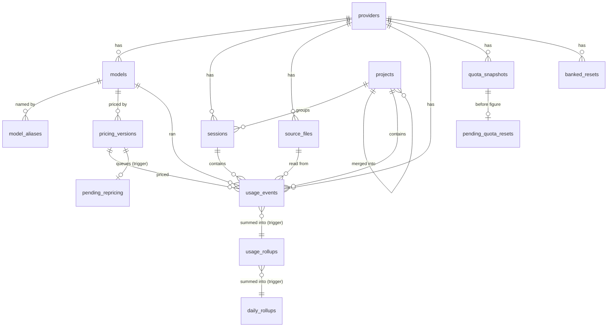
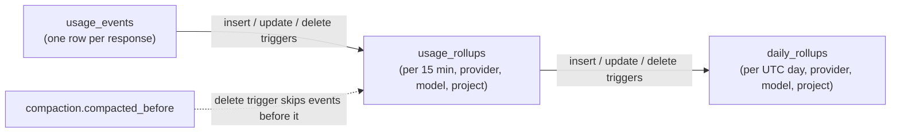
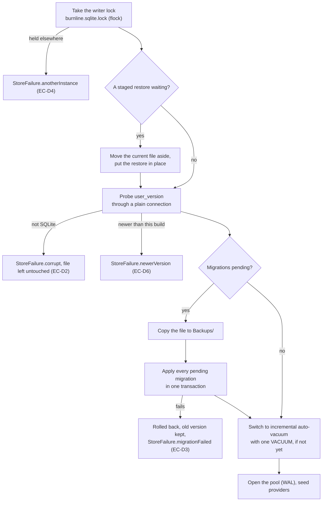

# Data model

Burnline keeps everything in one SQLite file. This document describes every
table, how the derived tables stay exact, how the file is opened and tuned, and
how the schema changes.

The DDL itself is authoritative and lives in `shared/schema/`. This document
describes the result of applying all fourteen migrations. If the two ever
disagree, the SQL is right and this page needs fixing.

## Conventions

| Kind of value | Stored as |
|---|---|
| Time | `INTEGER` epoch seconds, UTC |
| Money | `INTEGER` nanodollars (USD × 10⁹). Never `REAL`. |
| Rates | `INTEGER` nanodollars per million tokens |
| Booleans | `INTEGER` 0 or 1 |
| Quota amounts | `REAL`, in the provider's own unit. Not money. |
| Unknown | `NULL`. Never 0. |

## The tables at a glance

They fall into five groups:

| Group | Tables |
|---|---|
| Identity | `providers`, `models`, `model_aliases`, `projects`, `sessions`, `source_files` |
| Usage facts | `usage_events` |
| Derived sums | `usage_rollups`, `daily_rollups`, `compaction` |
| Prices | `pricing_versions`, `pending_repricing` |
| Live state and bookkeeping | `quota_snapshots`, `banked_resets`, `pending_quota_resets`, `notification_events`, `source_states`, `achievements`, `parser_errors` |

## Identity

### providers
One row per provider Burnline knows, seeded at every open, idempotently.

| Column | Notes |
|---|---|
| `key` | `codex`, `claude_code` or `cursor`. Unique. Matches `ProviderKey`'s raw values. |
| `display_name` | "Codex", "Claude Code", "Cursor" |
| `enabled` | Reserved; tracking is chosen in preferences today. |

### models
| Column | Notes |
|---|---|
| `provider_id`, `canonical_name` | Unique together |
| `display_name`, `family` | For display |
| `kind` | `model` or `non_model`. A non-model is shown but never priced. |

A model the manifest does not know is created on first sight with no price,
so its events are kept and priced once a later manifest names it.

### model_aliases
Raw names that resolve to a model, valid for a time.

| Column | Notes |
|---|---|
| `raw_model_name` | The plain form of the name: lowercased, trimmed, without a `provider/` prefix or a `[…]` variant |
| `model_id` | What it resolves to |
| `valid_from`, `valid_until` | Inclusive and exclusive; NULL means unbounded |
| `source` | `bundled` (from `model_aliases.json`) or `user` |

SQLite treats NULLs as distinct in a unique constraint, so an open-ended alias
is checked for duplicates in code.

### projects
| Column | Notes |
|---|---|
| `identity_kind` | `git_remote`, `git_root` or `path` |
| `identity_key` | `host/owner/repo`, or the SHA-256 of a path. Unique with the kind. |
| `display_name` | Derived from the identity, refreshed on every sighting |
| `user_alias` | The user's name for it. Never touched by ingestion. |
| `last_known_path` | Where it was last seen. Stays on this Mac. |
| `merged_into_id` | Set by a merge. Readers follow it; no usage row is rewritten. |
| `first_seen_at`, `last_seen_at` | |

Merges can chain. Aggregation resolves every chain at once with a recursive
query; resolving a single project follows at most 32 links and reports an
error past that, so a corrupt row cannot hang a read.

### sessions
| Column | Notes |
|---|---|
| `provider_id`, `source_session_id` | The provider's own session id, or one synthesised from the file when there is none. Unique together. |
| `project_id` | The project its records named |
| `started_at`, `ended_at` | Widened as later records arrive, never replaced |

Sessions, projects and source files are never removed by compaction, so
session counts and first-use dates cover all of history.

### source_files
One row per provider file, so the path is stored once rather than on every
event. Unique on `(provider_id, source_type, path)`. A source that is not a
file has a NULL path, matched with `IS`.

`source_type` is `claude_code_jsonl` or `codex_rollout_jsonl` today.

## Usage facts

### usage_events
One row per model response.

| Column | Notes |
|---|---|
| `provider_id`, `model_id`, `session_id`, `project_id` | Model, session and project may be NULL |
| `timestamp` | Epoch seconds, UTC |
| `input_tokens` | Uncached input only |
| `cached_input_tokens` | Cache reads |
| `cache_write_tokens` | All cache writes |
| `cache_write_1h_tokens` | The 1-hour part of the above. A check keeps it ≤ `cache_write_tokens`. |
| `output_tokens`, `reasoning_tokens` | Reasoning is already inside output |
| `service_tier` | As the provider wrote it, or NULL |
| `pricing_version_id`, `cost_nanos`, `pricing_confidence` | All NULL when unpriced |
| `cache_savings_nanos` | NULL when the price has no cache rates of its own; 0 with no cache tokens |
| `source_file_id`, `source_event_id` | Provenance. `(source_event_id, provider_id)` is unique. |
| `source_schema_version`, `source_offset` | The provider's format version, and the line's byte offset |
| `created_at` | When Burnline stored it |

Every token column has a check that it is non-negative.

**Indexes.** `idx_usage_ts (timestamp)` serves minute charts, session reads and
repricing. `idx_usage_project_ts (project_id, timestamp)` and
`idx_usage_session (session_id)` serve the project and session pages. The
unique index leads with the event id, so it can never be mistaken for a way to
find one provider's events. Earlier `(provider_id, timestamp)` and
`(model_id, timestamp)` indexes were dropped in migration 007: no query needed
them once the rollups existed.

**Why the event id leads the unique key.** Claude Code's message ids are
random, so every insert lands on a random page of that index. This costs about
4 KB of WAL per event at ten million rows, and deleting old history thins the
index's pages rather than freeing them. A hashed key would narrow both, but it
would move the uniqueness check into application code that every
implementation must copy exactly, and two events whose hashes collide would
merge. Uniqueness stays with SQLite (decided 1 November 2026).

## Derived sums

### usage_rollups
The same sums as the events, per 15-minute UTC bucket (`timestamp / 900`),
provider, model and project. The primary key is
`(bucket, provider_id, model_id, project_id)`. A missing model or project is
stored as 0, because NULL never matches in a key.

| Column | Notes |
|---|---|
| `events` | How many events |
| `input_tokens` … `reasoning_tokens` | Every token type |
| `cost_nanos` | Sum of priced events |
| `unpriced_events` | How many have no cost, for coverage |
| `cache_savings_nanos`, `cache_savings_tokens` | Savings, and the cache tokens they were computed for |

Three triggers on `usage_events` keep it exact **in the same transaction** as
the change:

- **insert** adds the event to its bucket, creating the row if needed;
- **update** of any summed column takes the old values out and puts the new
  ones in, so a repriced event or a more complete copy moves the totals;
- **delete** takes the event out and removes a row that reaches zero events.
  It fires only for events at or after the compaction boundary, so compacting
  old events leaves their sums in place.

Fifteen minutes is the bucket because every time-zone offset in use is a
multiple of it (India is UTC+5:30, Nepal +5:45). Every local day, week and
month is a whole number of buckets, so any calendar range sums exactly. Hourly
buckets would split them.

Rollups are derived, never a source of truth. For time after the compaction
boundary they can be rebuilt from events at any moment (Settings → Data →
Repair does it). Before the boundary they are all that remains.

### daily_rollups
The same sums per UTC day (`bucket / 96`), with `last_bucket`, the day's latest
15-minute bucket. Kept by three triggers on `usage_rollups`, so it covers
compacted history too. **Nothing but those triggers writes it**, so a repair
reports drift between it and the rollups but does not rewrite it.

A local day is not a UTC day: India's starts at 18:30 UTC. A range therefore
reads its whole UTC days from `daily_rollups` and the partial days at either
end from `usage_rollups`. The sum is identical, from about a tenth of the
rows. See [aggregation](aggregation.md#three-tiers).

### compaction
A single row (`id = 1`) holding `compacted_before`, a multiple of 900. Events
before it have been deleted and survive only in the rollups. See
[data lifecycle](data-lifecycle.md#compaction).

## Prices

### pricing_versions
Append-only. A price change is a new row; no row is updated or deleted.

| Column | Notes |
|---|---|
| `model_id` | |
| `valid_from`, `valid_until` | Inclusive, exclusive; `valid_until` NULL while current |
| `service_tier` | `standard`, `priority`, `flex`, `ultrafast` or `fast` |
| `above_prompt_tokens` | The prompt-length band; 0 for the base band |
| `input_nanos_per_mtok`, `cached_input_nanos_per_mtok`, `cache_write_nanos_per_mtok`, `cache_write_1h_nanos_per_mtok`, `output_nanos_per_mtok`, `reasoning_nanos_per_mtok` | NULL means not known, which is different from free |
| `currency` | Always `USD` |
| `source` | `litellm` for the generated manifest, `user` for a user's price |
| `confidence` | `exact`, `reconstructed`, `estimated` or `unknown` |

`idx_pricing_identity` makes `(model_id, service_tier, above_prompt_tokens,
valid_from, source)` unique, so loading the same manifest twice adds nothing.

### pending_repricing
One row per pricing version whose events have not all been re-priced yet. An
insert trigger on `pricing_versions` adds it in the same transaction as the
version. The application removes it only once every batch of repricing has
committed, and finishes any left over at the next launch.

## Live state and bookkeeping

### quota_snapshots
Append-only observations of quota windows.

| Column | Notes |
|---|---|
| `quota_key` | Stable within a provider: `five_hour`, `weekly`, `seven_day_opus`, or `<limit id>.<window>` for a model's own limit |
| `quota_name` | For display |
| `scope` | `account` or `surface` |
| `used`, `remaining`, `limit_value`, `unit` | When the provider reports amounts |
| `percentage_used` | 0 to 100 |
| `window_started_at`, `reset_at` | The reset time can move |
| `status` | `healthy`, `warning`, `critical`, `exhausted`, `reset_pending`, `unavailable`, `stale` or `unknown` |
| `source` | Which reader produced it, such as `codex_app_server` |

A snapshot is written when anything about a window changes, and at least
hourly while nothing does, so history shows the quiet hours too. Burn rate,
reset detection and the Limits page read this history.

### banked_resets
One row per banked reset the provider has reported, keyed by the provider's
own id (`source_reset_id`). `status` is `held`, `consumed`, `expired` or
`unknown`. `applies_to_quota_key` names what it clears (`codex` for the main
Codex limit, `claude` for Claude's windows).

### pending_quota_resets
An early reset still waiting to learn whether a banked reset caused it. Keyed
by `(provider_id, quota_key)`, with the cycle token, when it was seen, and
`before_snapshot_id`, a reference to the last snapshot before the drop rather
than a copy of it. Kept so a restart during the ten-minute wait loses neither
the reset nor its before figure.

### notification_events
Every alert decided, shown or not.

| Column | Notes |
|---|---|
| `provider_id` | NULL for a spend alert, which covers every provider |
| `quota_key`, `notification_type`, `threshold` | `threshold` is a percentage, or for spend the limit in nanodollars |
| `cycle_token` | A window's cycle token, `day:YYYY-MM-DD` or `week:YYYY-MM-DD` for spend, or `expires:<epoch>` for a banked-reset reminder |
| `fired_at` | |

Indexed for the deduplication lookup and by `fired_at`, since only the last 40
days are loaded.

### source_states
How far each provider file has been read: `source_identifier` (the path),
`inode`, `file_size`, `last_modified_at` and `last_modified_nanoseconds`,
`last_offset`, `last_event_identifier` (the last event id read),
`last_scan_at`, and `resume_state`, opaque text only the provider's parser
reads. A NULL nanosecond field marks a state written before migration 005;
that file is read again once to get a precise stat. A state is removed when
its provider no longer lists the file.

### achievements
Each achievement earned, once. `key` and `tier` are unique together. `tier` is
the threshold, the provider for a first session, or the period for a
repeatable one. `provider_id` is set for a provider's own achievement, and
`value` holds the figure behind it: the threshold, a percentage, or which
monthly challenge it was. `awarded_at` is when the history first met it, not when
Burnline noticed, and is never rewritten. `announced_at` is when a notification
was decided; `celebrated_at` is when the app last played its arrival.

### parser_errors
A reason and a line number for a line that could not be read or was patched.
**Never the line itself**: it may hold prompt text or code. At most 20 are kept
in detail per file per pass, and they are pruned after 90 days.

## Opening the database

Opening is where every dangerous case is decided, in this order:

- The version probe uses a plain connection, not a read-only one, because
  SQLite cannot open a WAL database read-only while its `-shm` file is missing,
  which is exactly the state after a clean shutdown. A plain connection leaves
  the journal mode alone and writes nothing to the file.
- Opening the pool switches the journal to WAL, which writes to the file, so
  nothing opens the pool before the probe has passed.
- No backup, no migration. Backups are pruned to the newest three when a new
  one is taken.
- Burnline does **not** use GRDB's `DatabaseMigrator`, which records applied
  migrations in its own table. A database migrated by another implementation
  would have no rows there, and GRDB would apply migration 1 again. `Schema`
  reads `user_version`, applies each later file, and sets the version.
- Schema files must be numbered 1, 2, 3… with no gap or repeat. A gap would
  make the recorded version ambiguous, so the loader refuses one.
- A **read-only** open mode exists for tools such as export alongside the
  running app. It takes no lock, applies no migration, and relies on the
  writer's `-shm` file.

## Connection settings

Set per connection by the app, never in a migration.

| Setting | Value | Why |
|---|---|---|
| `journal_mode` | WAL | Concurrent readers beside one writer |
| `foreign_keys` | ON | |
| busy timeout | 5 s | |
| `synchronous` (writer) | NORMAL | WAL syncs at checkpoints, not every commit. Power loss can drop the last commits but cannot corrupt the file, and a dropped batch is read again, because its events and its offset commit together. |
| `wal_autocheckpoint` (writer) | 8,192 pages (32 MB) | Each checkpoint makes two full syncs. At the default 1,000 pages they were three quarters of import time. |
| `journal_size_limit` (writer) | 64 MB | The WAL is cut back after a checkpoint, so one large import does not leave a large file. |
| `temp_store` (writer) | MEMORY | Upserts write a statement journal; in memory it costs no I/O. |
| `cache_size` (writer) | 32 MB | The default 2 MB re-read index pages on nearly every insert. |
| readers | SQLite defaults | Their queries walk an index range or the small rollup tables. A 1 GB `mmap_size` made every measured query slightly slower. |

These were tuned by measurement on ten million synthetic events; see
[performance](performance.md).

## Size

Measured 1 November 2026 on ten million synthetic events over five years:
**248 bytes per event** with indexes, down from 412 before migration 007 moved
paths into `source_files`. A real history of about 34,000 events was 13.4 MB
before that change.

With the default 180-day detail window, compaction bounds the file at about
the window's worth of events: ten million events over five years went from
2.49 GB to 247 MB. A heavy user's database settles near 2 GB.

## Migration history

| # | File | What it did |
|---|---|---|
| 1 | `001_initial.sql` | Every core table |
| 2 | `002_cache_write_duration.sql` | `cache_write_1h_tokens` and its rate, since Anthropic prices a 1-hour write about 2× input and a 5-minute one 1.25× |
| 3 | `003_resume_state.sql` | `source_states.resume_state`, for Codex files resumed mid-file |
| 4 | `004_service_tier.sql` | `usage_events.service_tier` |
| 5 | `005_source_mtime_nanoseconds.sql` | Nanosecond modification times, so same-size rewrites within a second are noticed |
| 6 | `006_pricing_dimensions.sql` | Service tier and prompt-length band on prices; the unique pricing identity |
| 7 | `007_source_files.sql` | Paths moved to `source_files`; two unneeded indexes dropped; unique key reordered |
| 8 | `008_usage_rollups.sql` | `usage_rollups` and its triggers |
| 9 | `009_compaction.sql` | `compaction`; per-event cache savings; triggers that leave compacted buckets alone |
| 10 | `010_daily_rollups.sql` | `daily_rollups` and its triggers |
| 11 | `011_pending_repricing.sql` | `pending_repricing` and its trigger |
| 12 | `012_notification_events.sql` | `notification_events` rebuilt so a spend alert has no provider; `pending_quota_resets` |
| 13 | `013_achievement_moments.sql` | `announced_at`, `celebrated_at` |
| 14 | `014_achievement_catalogue.sql` | Removed achievements from the old adaptive monthly challenge and the retired 10M rung, to be judged again |

[Development](development.md#adding-a-migration) explains how to add the next
one.
