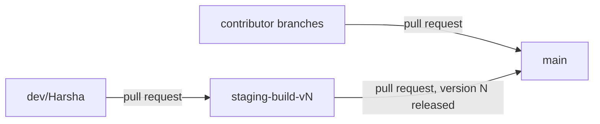

# Development

Everything needed to build, run and change Burnline on a Mac.

## Requirements

| Need | Version |
|---|---|
| macOS | 14 or later to run the app. Building needs a macOS that runs the Xcode below. |
| Xcode | 26 or later (Swift 6.2 tools; the package manifest declares `swift-tools-version: 6.2`) |
| Python | 3, standard library only, for the pricing tool and the icon script |
| Git | Any recent version |

No Apple Developer account is needed. There are no other package managers:
Swift Package Manager fetches GRDB, zstd and Lottie on the first build.

## First build

```sh
git clone https://github.com/igharsha7/Burnline-AI-Usage-Tracker.git
cd Burnline-AI-Usage-Tracker
swift test --package-path macos/Packages     # build and test every module
open macos/Burnline.xcodeproj                # the app target
```

In Xcode, choose the **Burnline** scheme and run. Burnline opens its
dashboard (onboarding on a first run) and puts a flame in the menu bar; it
keeps running there when the window is closed. Settings → General → "Menu bar
only" removes the Dock icon. Run debug builds against a scratch store (below).

## Commands

| Command | What it does |
|---|---|
| `swift test --package-path macos/Packages` | Every module's tests, no Xcode needed |
| `swift test --package-path macos/Packages --filter ComparisonEngineTests` | One suite |
| `macos/scripts/check-license-headers.sh` | Fails if a source file lacks the AGPL header. Also runs as an Xcode build phase. |
| `python3 shared/pricing/tools/update_pricing.py` | Appends LiteLLM's price changes to `shared/pricing/pricing.json` |
| `python3 -m unittest -v` (in `shared/pricing/tools`) | The pricing generator's tests |
| `python3 macos/scripts/generate-icon.py` | Redraws the app icon, `macos/Burnline/AppIcon.icon` |

The opt-in tests that read real data or measure performance are listed in
[testing](testing.md#opt-in-tests).

## Running a debug build safely

A debug build is a live app: by default it reads your real provider history
and writes your real database at
`~/Library/Application Support/Burnline/burnline.sqlite`. An unreleased
migration would then migrate that database, and an older release could no
longer open it. Launch debug builds with their own store instead:

```sh
open -n --env BURNLINE_STORE_DIR=/path/to/scratch \
        --env BURNLINE_SKIP_KEYCHAIN=1 \
        --env BURNLINE_DEFAULTS_SUITE=burnline-scratch \
        /path/to/DerivedData/.../Debug/Burnline.app
```

| Variable | Effect |
|---|---|
| `BURNLINE_STORE_DIR` | Keeps the database, its side files and backups in that directory instead of Application Support |
| `BURNLINE_SKIP_KEYCHAIN` | Skips reading Claude Code's login from the Keychain. A debug build is ad-hoc signed, so its signature changes every build and macOS would ask for the Keychain password at every launch. Claude quota then comes through Claude Code itself. |
| `BURNLINE_DEFAULTS_SUITE` | Keeps preferences, onboarding progress and the chosen providers in a defaults domain of their own. A new name shows the first run again without touching your real preferences. |

**Release builds ignore all three.** Provider history is still read from the
real homes (`~/.claude`, `~/.codex`), read-only, as always.

## Where things go

| You are adding | Put it in |
|---|---|
| Library code | A module under `macos/Packages/Sources/`, respecting the [dependency rule](architecture.md#the-dependency-rule) |
| App-target code | `macos/Burnline/`. It is a **synchronised folder**: Xcode picks up any file placed there. Never add file references to the project by hand. |
| A migration | `shared/schema/` (see [below](#adding-a-migration)) |
| Prices, model aliases | `shared/pricing/` (generated; see [pricing](pricing.md)) |
| A comparison unit | `shared/corpus/comparisons.json` (see [comparisons](comparisons.md#adding-a-unit)) |
| A UI resource | `macos/Packages/Sources/BurnlineUI/` under `ProviderLogos`, `Fonts` or `Animations`, with a README stating its license |
| Tests | The matching target in `macos/Packages/Tests/` |
| Documentation | `docs/` |

`shared/schema`, `shared/pricing` and `shared/corpus` are bundled into the
app as folder references, so a new migration, manifest or comparison ships
without editing the project.

## Adding a migration

The schema is the interface between platforms, so it lives in SQL files,
never in application code.

1. Create `shared/schema/NNN_short_name.sql`, numbered one past the last.
   Numbers run 1, 2, 3… with no gaps or repeats; the loader refuses either.
2. Start it with the license header and a comment saying what it changes and
   why, as the existing files do.
3. Plain SQLite only: no library-specific syntax, so any binding on any
   platform can apply it.
4. Never put connection pragmas in a migration (`journal_mode`,
   `synchronous`, `foreign_keys` and the like). They belong to the app. See
   [data model](data-model.md#connection-settings).
5. If it touches `usage_events`, check the rollup triggers still keep
   `usage_rollups` and `daily_rollups` exact, including the compaction rules.
6. Write the test first: a database at the previous version, populated,
   migrated forward with its facts intact. `DatabaseLifecycleTests` migrates
   every released version this way; extend its range.
7. Add a row to the migration history in [data model](data-model.md#migration-history)
   and update the tables it changes.

**Never edit a released migration.** Two users on the same version would then
have different databases. A mistake in a released file is fixed by a new one.

At launch the app copies the database to `Backups/` and applies every
pending migration in one transaction; a failure rolls back and keeps the old
version. That is why your scratch store matters during development.

## Adding a setting

1. Add a key as a `static let` beside the others (`SettingsModel`, or the
   model that owns it), with a comment saying what it holds and what its
   absence means.
2. Read it with a default, so a missing key behaves sensibly on first launch
   and after an upgrade.
3. Add the key to `PreferenceBackup.keys` so it travels with a backup.
4. Add it to the preferences table in [interface](interface.md).
5. If a service needs it, pass the value in (as Settings does through
   `LiveIngestion`), or give the service a store that takes its
   `UserDefaults` as a parameter (as `AlertSettingsStore` and
   `UserDefaultsRecentStore` do), so tests can use a defaults suite of their
   own.

## Prices

`shared/pricing/pricing.json` is append-only history. **Never edit a version
in it by hand.**

- `update_pricing.py` fetches LiteLLM's price list and appends only what
  changed, as new versions dated today. Options: `--litellm` (a URL or path),
  `--manifest`, `--today YYYY-MM-DD`, `--seed`.
- A daily GitHub Actions workflow (`.github/workflows/update-pricing.yml`,
  04:17 UTC) runs the generator's tests, appends to the history on the
  data-only `pricing-data` branch, and pushes. The app fetches that branch.
- The bundled copy in `shared/pricing/pricing.json` is refreshed from
  `pricing-data` before each release.

See [pricing](pricing.md) for the manifest format and how the app uses it.

## The app icon

`macos/Burnline/AppIcon.icon` is a layered Icon Composer document written by
`macos/scripts/generate-icon.py` from named measurements. Change the
measurements in the script and run it again; never edit the `.icon` by hand.
`macos/design/README.md` explains the layers and how to preview the icon with
Icon Composer's `ictool`.

## License headers

Every `.swift`, `.sql`, `.sh` and `.py` file starts with the AGPL header,
within its first 20 lines. Copy it from any existing file:

```swift
//
//  FileName.swift
//  Burnline
//
//  Copyright (C) 2026 Challapalli Harshavardhan Reddy
//  Licensed under the GNU Affero General Public License v3. See LICENSE and NOTICE.
```

`macos/scripts/check-license-headers.sh` checks every file and runs as a build
phase of the app, so a missing header fails the build. See
[licensing](licensing.md).

## Code style

- **Swift 6 strict concurrency.** Library modules use approachable
  concurrency; the UI module is main-actor by default. Ingestion, quota and
  notifications run behind actors. See [architecture](architecture.md#concurrency).
- **No wall clock, no chance.** Take a `WallClock` and, where needed, a
  random-number generator. Only `BurnlineCore/Time/` may read the real clock,
  and the fitness tests enforce it.
- **No floating point in the cost path.** Money is integer nanodollars. The
  fitness tests enforce it in `BurnlineCore/Money/`.
- **Comments explain, they do not narrate.** A short note on a type or
  function saying what it is for and how it is used. Keep comments in step
  with the code.
- **No hardcoded paths or magic numbers.** Name constants; read locations
  from the environment where the provider does (`CLAUDE_CONFIG_DIR`,
  `CODEX_HOME`).
- **Never store or log content.** Usage metadata only; see
  [privacy and security](privacy-and-security.md).

## Branches



- `main` receives nothing directly. It is updated only by pull requests: from
  a staging branch, or from a contributor.
- `staging-build-vN` collects finished work for release N. The number rises
  each time a staging branch is merged to `main`.
- `dev/Harsha` is the maintainer's day-to-day line. The staging branches are
  the maintainer's release line too.
- `nightly` is the maintainer's branch for nightly builds *(to build)*: work
  in progress toward the next release, built each night it changes (see
  [channels](releasing.md#channels-to-build)).
- Contributors branch from `main` and open their pull request against `main`,
  never against a staging branch.

Platforms are **directories, never branches**: `macos/` today, and `windows/`
for the Windows version in progress, with language-neutral contracts in
`shared/`.

## CI

`.github/workflows/ci.yml` runs on every pull request to `main` or a staging
branch, and on every push to `nightly`, in three jobs:

- **Tests and build**, on a macOS runner with the newest Xcode 26: the test
  suite (with coverage), the license header check, the coverage floor and an
  unsigned app build. Each step runs even if an earlier one failed.
- **Performance**, on a second macOS runner at the same time: the
  [performance gate](performance.md#the-performance-gate).
- **Checks**, once both finish: `.github/scripts/ci_report.py` turns their logs
  into one report (a table of the checks, then for each failure the failing
  tests, files or figures and the page to read), writes it to the run's
  summary page and uploads it as an artifact. Checks fails if either job did,
  and it is the status the branch rules require.

`.github/workflows/ci-report.yml` posts that report on the pull request, as one
comment it updates on every push. It is a separate workflow so that the pull
request's code never runs with write access: `ci.yml` has a read-only token,
and `ci-report.yml` runs from `main`, checks out nothing, and posts the report
only after checking that the pull request's head is still the commit tested.
Changes to it take effect once they reach `main`. Never run pull-request code
under `pull_request_target`.

Two branch rulesets enforce the result:

- **Checks before merging**, on `main` and `staging-build-*`: changes arrive
  only by pull request, **Checks** must pass, and the branch cannot be
  force-pushed or deleted. Nobody can bypass it.
- **Maintainer approval on main**: a pull request into `main` needs an
  approving review from a code owner (`.github/CODEOWNERS`), on its latest
  push, with every review thread resolved. The maintainer can merge their own
  pull requests past the review, never past the checks.

## Commits

Commit messages describe the change for a reader, in a sentence-case
imperative subject, with no prefix:

```
Import a first history about four times faster

Measured on this Mac, reading was nine tenths of a first import…
```

The body says what was wrong and how it was solved, with measurements where
there are any. Commits are signed.
