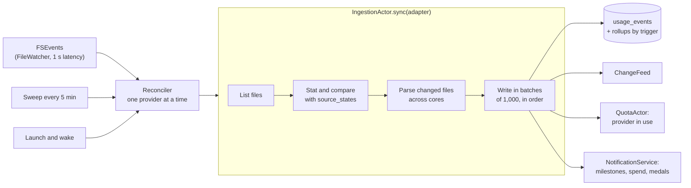
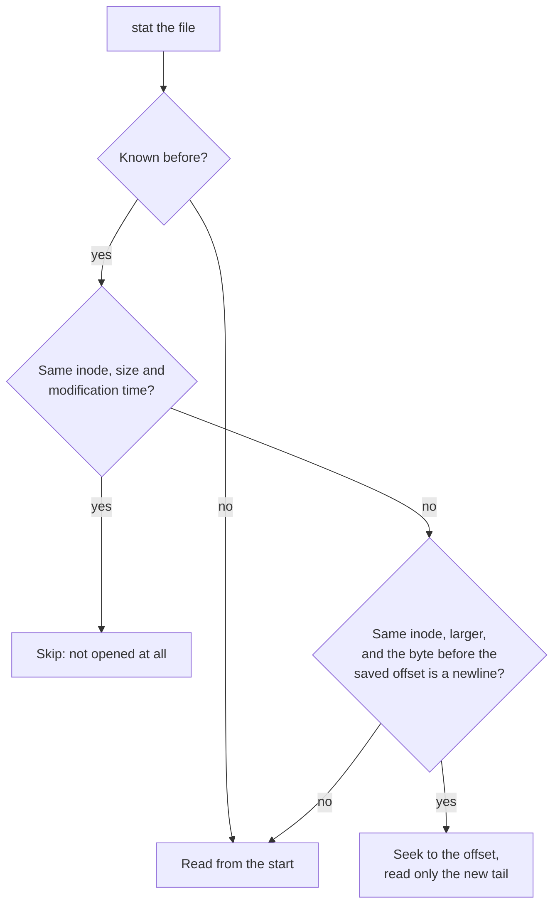

# Ingestion

How usage gets from a provider's files into the database: what starts a sync,
how much of each file is read, how a batch is written, and what happens when
something goes wrong. What each provider's files look like is in
[providers](providers.md).

## The pipeline

## What starts a sync

`Reconciler` keeps the database in step with every tracked provider. Three
things start the same incremental sync:

1. **A file watcher.** `FileWatcher` wraps FSEvents on each of a provider's
   homes with a one-second latency. It reports only *that* something changed,
   never what: a sync stats every file anyway, and knowing which one is not
   worth the bookkeeping. Bursts collapse into one pending signal. This is how
   a new reply shows up within seconds.
2. **A sweep every five minutes**, because FSEvents are not delivered while
   the Mac sleeps or the app is not running, and a provider installed after
   launch has no watcher yet.
3. **An explicit reconcile** at launch and after every wake (EC-I10).

A spurious trigger costs one `stat` per file. Providers sync one at a time
and independently: a provider whose sync fails is recorded and the rest carry
on. **Only tracked providers are read**; an untracked provider's files are
never opened.

## How much of a file to read

Each file's last state is in `source_states`: the offset just past the last
complete line, the inode, the size, and the modification time to the
nanosecond.

Everything that is not plainly "the same file, grown by appending" is read
again from the start: a file that shrank, one with a new inode, one rewritten
in place at the same size, or one whose saved offset now falls in the middle
of a line (EC-I3). Reading again is always safe, because the unique key on
`(provider, source event id)` absorbs events already stored.

A **compressed** Codex archive (`.jsonl.zst`) cannot be entered midway, so it
is always read whole. Archives do not change, so after the first read the stat
comparison skips them. Their offsets count decompressed bytes.

A state written before nanosecond times existed (migration 005) has none, and
its file is read again once to establish a precise stat.

## Parsing

Adapters parse synchronously, streaming the file in 1 MB chunks (`LineReader`),
so a transcript of any size is read without loading it whole (EC-I12).

- **A final line with no newline is left for the next pass** (EC-I2). It may
  still be being written, and reading it now would parse half a record.
- **Markers filter lines before they are copied.** Each adapter names the
  byte strings its records contain (`"assistant"` for Claude Code, the record
  types for Codex). Lines without one are skipped from their raw bytes. Most
  of a transcript is message text no adapter reads, and this is what keeps a
  first import fast. Codex looks for its record type only near the start of a
  line, where Codex writes it; searching whole lines made a first import
  several times slower.
- **Only the needed fields are decoded.** Message content never becomes a
  Swift value, let alone a stored one.
- **A malformed line is recorded and skipped** (EC-I1); the rest of the file
  carries on. Its reason names the field but quotes nothing. At most 20 issues
  per file are kept in detail; the count stays honest beyond that.
- **An absent or negative token count becomes zero and is recorded** (EC-I8).
- **Unknown fields are ignored** (EC-I5); the provider's format version is kept
  as `source_schema_version`.
- A record with no session id gets one synthesised from its file (EC-I7). One
  with no working directory has no project and is grouped as "No project"
  (EC-I6). One with no model is still counted, under an unknown model (EC-M5).

Several files are parsed at once across the cores. The actor blocks while they
parse rather than awaiting, so another sync of the same files cannot start
midway. Files are then written in their original order.

What leaves an adapter is a `ParseOutput`: the records (`IncomingUsage`, with
raw identities), the issues, the end offset, and the parser's resume state for
that offset.

### Resume state

Some formats state context once and rely on it many lines later. A Codex
rollout names its model and working directory at the start of each turn, and
the token records that follow carry neither. A pass that starts mid-file needs
what was in force at its offset, so the parser returns it as
`resume_state`, stored with the offset. Claude Code needs none: every line
stands alone.

The text is opaque to everything but the parser that wrote it. A parser given
no state, or state it cannot read, starts the file over, which costs time but
never correctness.

## Writing

`IngestionActor` is the only writer of usage. A file's records are written in
batches of 1,000, each in one transaction (`IngestionBatch`):

1. **Resolve identities once per batch.** The batch's distinct sessions,
   projects, models and source file are looked up or created once, not per
   event. A model whose aliases have no time bounds resolves the same way at
   every instant and is looked up once; one with bounded aliases is resolved
   per event.
2. **Resolve the project.** The working directory becomes a project identity
   (see [providers](providers.md#project-identity)). A record whose directory
   no longer exists joins its session's existing project rather than creating
   one from a stale path.
3. **Price each event** with the pure `Pricer`, against the model's versions
   loaded once per batch. An unpriced event gets NULL cost, never 0. Cache
   savings are computed with the same rates.
4. **Drop late history** (`LateHistory`). An event before the compaction
   boundary is refused if its 15-minute bucket holds any of the provider's
   compacted history, because the rollups may already count it (EC-D11). A
   reply is judged whole: Claude Code writes one reply over several lines,
   each with its own time, so every record sharing a refused record's id is
   refused too.
5. **Insert or complete.** A new `(provider, source event id)` is inserted. A
   repeat replaces the stored event only if it is more complete: more output
   tokens, then, on a tie, more prompt tokens (input plus cache reads and
   writes). Read order does not matter.
6. **Record parser issues** with the first batch.
7. **Advance the offset, resume state and stat with the last batch.**

Steps 1–7 commit together or not at all (EC-I9). A crash between batches
leaves the old offset, so the next pass reads again lines whose events are
already stored, and the unique key absorbs them. Nothing is lost and nothing
doubles. Rollups and daily rollups change in the same transaction, by trigger.

Sessions are written with their earliest and latest record times, which is
what writing every record's time would leave, since a session keeps only its
span.

## When things fail

| Failure | What happens |
|---|---|
| One line will not parse | Recorded as a reason; the file continues (EC-I1) |
| One file cannot be read | Counted and skipped; the sync continues |
| One provider's sync throws | Recorded as that provider's health; other providers carry on |
| The store cannot write (disk full) | The transaction rolls back, the sync stops and throws, since continuing would only fail again (EC-D1). `Reconciler` announces it on `ChangeFeed`; the menu-bar flame becomes a warning triangle, the popover leads with the reason, and a banner sits over every dashboard page until a sync saves again. |
| The provider is not installed | A detection state, not an error (EC-I11) |

Provider health (`ProviderHealth`) is healthy with the time of the last import,
degraded with a reason and since when, not installed, or unavailable with a
reason. One provider's health never changes another's.

## After a sync

- `ChangeFeed` tells every view model to reload.
- `QuotaActor` hears that the provider is in use and reads its quota every 5
  minutes instead of every 15.
- `NotificationService` checks lifetime milestones and spend alerts, then
  judges achievements, at most once every five minutes, since judging reads all
  of history.
- The sync's result (files read, files unchanged, events written, issues)
  feeds Settings → Providers and the debug log.

## Tracking, adding and re-scanning

- **Choosing providers.** Onboarding lists the providers, marks the ones whose
  tool is found on this Mac, and imports only what the user chooses. The choice
  is the `trackedProviders` preference.
- **Add Provider**, from the end of the sidebar's provider group, starts
  tracking another one: its history is imported at once, with progress, and
  its quota is read from then on. Any medals that history had already earned
  are shown.
- **Re-scan History** (Settings → Providers) or **Re-scan from the Start**
  (Settings → Data → Repair) forgets every file's position and reads
  everything again. What the providers still keep and
  Burnline lost or never read comes back, including usage the user deleted.
  Compacted history is never counted twice.

## First import

A first import reads everything each provider still has. On an M4 with 2.8
GB of transcripts, a release build imports Claude Code in about 1.3 s and
Codex in about 1.6 s (about 12 s for setup in a debug build); reading, not
writing, is nine tenths of it. `BURNLINE_IMPORT_TIMING=1` times your own (see
[testing](testing.md#opt-in-tests) and [performance](performance.md#first-import)). Onboarding shows sessions
read so far, rising, so a long import never looks stuck.

**Lifetime depends on what providers kept.** Claude Code deletes transcripts
after `cleanupPeriodDays`, 30 days by default. History deleted before Burnline
first ran cannot be recovered. From then on, Burnline's database is the
lasting record.
