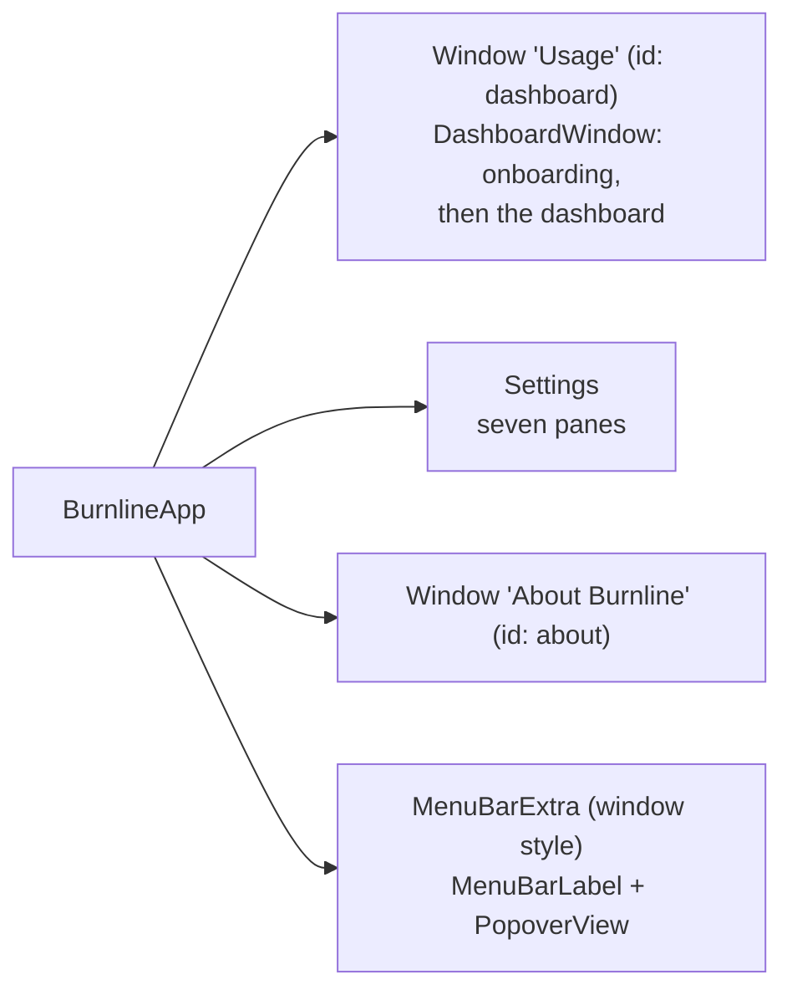

# Interface

Every surface of the app: the scenes, the menu bar and popover, the dashboard
and its pages, onboarding, the tour, Settings, keyboard shortcuts, the design
tokens, and accessibility. All of it lives in `BurnlineUI`, except the scene
declarations in `macos/Burnline/BurnlineApp.swift`.

## Scenes

- **One dashboard over one model.** The dashboard is a `Window`, not a
  `WindowGroup`, so File has no New Window. Its default size is 1120 × 860
  with a unified toolbar.
- **Closing the dashboard does not quit.** The menu-bar item stays.
- **Dock or menu bar only.** Burnline is a regular app with a Dock icon by
  default. The bundle does not set `LSUIElement`; Settings → General → "Menu
  bar only" (`menuBarOnly`) switches the activation policy at run time
  (`DockPresence`). In that mode there is no Dock icon and the dashboard does
  not open at launch, except on the first run, which always shows onboarding.
- **Open at login** uses `SMAppService` (`LoginItem`), off until chosen. If
  macOS is holding it for approval, Settings says so and links to Login Items.
- **Dark only.** The app sets the dark aqua appearance before any window
  opens, so every window, the popover, Settings and About draw dark whatever
  the system is set to. There is no light palette.

## Menu bar

### The label

`MenuBarLabel` shows a flame and, by default, today's cost. The flame
**burns with the work** (see [heat](#heat)):

| Stage | Flame |
|---|---|
| Idle: nothing live | an outline (`flame`) |
| Warm: live, at a typical pace or below | filled (`flame.fill`) |
| Hot: busy | filled, in ember |
| Blazing: at a peak or beyond | filled, in red |
| Saving is failing (EC-D1) | a warning triangle, which outranks everything |

It changes only when the stage does and never animates, so it costs nothing
idle. A coloured flame is drawn as a non-template image, since the menu bar
draws template images in its own ink.

**What the label shows** (`MenuBarTitleMode`, preference `menuBarTitle`):
icon only, today's cost (default), today's tokens, the fullest quota, or each
provider's fullest quota.

### The popover

`PopoverView`, 340 points wide, drawn on the dashboard's own surfaces rather
than the system's glass: an opaque background, cards in `surface`, text in the
tokens. **Limits come first**; everything else is a line or two, because
analysis belongs in the dashboard.

From top to bottom:

1. **A store failure**, if there is one: why usage is not being saved or the
   database did not open, with the dashboard as the place to deal with it.
2. **Today**: equivalent cost and tokens on one line. Coverage is in the help
   text, and said only when some of it is unpriced (EC-U3).
3. **Limits**, per provider. With **two providers or fewer** each gets a full
   card: its plan, banked resets, staleness, one row per window (name, a
   fuse bar with an even-pace tick, the percentage, and the time to its reset,
   with the reset's moment in help), and a warning line only when a window is
   on course to run out before it resets. With **three or more**, each folds
   into a two-line row with its windows side by side, which opens into its
   card, so the popover never grows long. Rows redraw on a one-minute cadence,
   the precision their countdowns show. A countdown at zero reads as waiting
   for the provider to confirm (EC-T6).
4. **Active sessions**: the sessions producing usage now, by project, each
   with its cost an hour at its current pace, and the new tokens a minute
   across them in the header. Cache re-reads are left out of that rate, which
   would otherwise look a hundred times larger.
5. **One comparison**.
6. **Open Dashboard**, refresh (Command-R), and an options menu: Settings…
   (Command-,), About Burnline, Quit Burnline (Command-Q).

Figures roll toward new values the way the dashboard's do. The provider dot
on each bar's burning point takes that provider's colour.

`StatusModel` holds what the popover shows, so it opens from memory. It is
built empty at launch, connected once ingestion is up, then follows
`ChangeFeed`. It also reloads at midnight and when live activity lapses, since
nothing else announces either.

`BURNLINE_RENDER=/path/popover.png swift test --filter MenuBarTests` renders
the popover from fixtures with two providers and with three.

### Heat

How hard usage is burning now, judged against **this person's own history**
rather than fixed figures: what is hot for one is idle for another.

- `HeatScale` takes the 5-minute stretches of the last 30 days that held
  priced usage and sets three points from their cost an hour: the typical one
  (median), a busy one (75th percentile) and a peak (95th). Until there are 24
  such stretches, it uses a starting scale of $5, $15 and $40 an hour.
- Heat is the live sessions' combined cost an hour on that scale: 0 with
  nothing live, ⅓ at a typical pace, ⅔ when busy, 1 at a peak and beyond.
  Processed tokens would not do, being mostly cache re-reads.
- The scale is read at launch and each midnight.
- **In the popover**, `HeatGlow` draws ember light rising from the top edge and
  along the rim, as strong as the heat, reddening at a peak, with a slow
  flicker from three out-of-step waves. Nothing at all when nothing is live.
- **It flickers only while its window is on screen.** The menu bar keeps the
  popover's window alive when hidden, so SwiftUI does not pause it; the glow
  watches the window's occlusion state (`OnScreen`) and pauses its timeline
  when hidden, idle, or under Reduce Motion. Without this, a closed popover
  cost 25–40% CPU.

## The dashboard

`DashboardView`: a compact sidebar beside the chosen page, under a native
toolbar. On macOS 26 the system draws the sidebar and toolbar in Liquid Glass,
the navigation layer Apple reserves glass for. Pages are opaque.

### Toolbar

- **Range**: Today, 7D, 30D, 90D, YTD, 1Y, All, in one row so the chosen range
  is always in view. A drilled or custom range selects none; the window's
  subtitle names it.
- **Measure**: Cost, Tokens, Limits. Cost and tokens apply to every page;
  Limits is the overview's own.
- **Refresh** (Command-R).

The Activity page has its own range and measure, and Limits are now rather
than a range, so the range control stands aside for both.

### Sidebar

Overview; **Providers**, one group of the tracked providers, each with its logo
(the group can grow long, so it folds); Projects; Sessions; Activity;
Achievements.

- A provider says something under its name **only when it is not up to
  date**, so a quiet sidebar means all is well. One not detected says so
  without being opened (EC-I11).
- **Add Provider** at the end of the group opens a sheet: pick a provider not
  yet tracked, see whether its tool is on this Mac and what Burnline will read,
  import its history while watching it arrive, and see any medals it earned.
- Achievements shows a badge with how many medal arrivals wait.
- **The foot** says what this build is, the version or a nightly's night-sky card, with
  a button to check for updates. An update found appears above it as
  **Update to 0.2.0** until it is installed. See [updates](updates.md).

### Pages

Every page is the same scrolling column for a narrower scope (`Scope`): all
usage, one provider, one project, or one session. Pages are capped in width
and centred. Each applies the global filters except a session's, which is
already as narrow as usage gets. Sections arrive in reading order, each a step
behind the one above; new figures for a page already shown morph instead.

**Overview**, top to bottom:

1. The **comparison line**, changing every 25 seconds
   ([comparisons](comparisons.md)).
2. **Filter chips**: the global filters (provider, model, project), kept
   between launches and always visible, so a number never changes unexplained.
3. **The hero**: the range's figure; the change against the previous period to
   the same point; how the providers split it, as one bar in their colours and
   a row each with figure and share. A provider's row also shows or hides its
   chart line. An ⓘ beside the cost opens an explanation of equivalent cost and
   its coverage.
4. **The chart**: one smoothed line per provider over its area, a shaded span
   where tracking had not begun, and a hover card that glides between buckets.
   Monotone interpolation keeps the curve smooth without inventing values: it
   never dips below zero or peaks above a bucket's real figure. Lines draw in
   from the left on first appearance, and again, quicker, when the range or
   measure changes. Each line ends in an ember at "now".
5. **Where the tokens went** (`TokenMixCard`): a bar split into cache reads,
   input, cache writes and output, then the kinds other than cache reads
   enlarged beneath it through a funnel, since cache reads are usually so much
   of the whole that the rest would be slivers. Pointing at a kind picks it
   out everywhere and splits it by provider. Beside it, cache savings as the
   bill without caching against the bill with it.
6. **The breakdown table** (below).
7. **The ten-day ledger**: the same table with a day bucket and ten rows.
   Untracked days say so.
8. **Comparisons** for the range.

**A provider's page** adds its health, live activity and limits. **Projects** and **Sessions** are
each one table, a screenful at a time. **A project's page** shows its path,
first and last seen, **Rename**, **Merge Into**, and **Unmerge** for anything
merged into it; merging and unmerging only redirect, so both can be undone
(EC-P7). **A session's page** shows its provider, project and span, and its
figures over that span alone. Burnline shows usage, never what was said.

Rows open what they name; Command-[ goes back from a project or session.

### The breakdown table

`BreakdownTable` **changes shape rather than re-sorting**:

| Grouped by | Columns |
|---|---|
| model, project, session | Name / Cost / Share / Tokens, ranked |
| a time bucket | Hour (or Day…) / one column per provider / Total / Tokens |

One component expresses both, and the ten-day ledger is the same component.
Every numeric column sorts by number. Rows carry a quiet magnitude bar. A
ranked row **opens in place** to show its tokens by kind, the share of its
input served from cache, what a million of its tokens cost, when it was last
used, and the way into it. A bucket row narrows the dashboard to that span. A
long ranking shows its top rows until asked for all. Command-F filters the
rows.

### Limits

`LimitsView`, from the same model as the menu bar, so the two never disagree.

- **A board of ring tiles**, one per provider, wrapping so four providers
  still read at once. Each tile has concentric rings, innermost first, each
  filling with use and ticked where an even pace would be; a headline of where
  it stands; and when its most pressing window resets.
- **One provider or all**: a segmented switch (`limitsShowAll`) shows the
  chosen provider's details (`limitsProvider`) or every provider's.
- **A card per window**: its burn-down (the readings as a line over the
  window's span, the even pace from empty to full, and the current rate carried
  on to the reset or to the limit if sooner), its banked resets, how full its
  earlier windows got (newest at the right, with how often the limit was
  reached), and the window's usage from this Mac as a comparison.
- Each window is judged (`WindowOutlook`): barely touched, comfortably under
  pace, right on pace, running ahead, runs out early (by how much), or reached.
  The tile's headline comes from the most pressing window.

### Failure states

No failure shows as an empty or endlessly loading page.

- **The database does not open** (corrupt, newer, failed migration, a second
  copy, a full disk): the dashboard becomes `StoreFailureView`, saying what
  happened, that nothing was lost, and the ways out: Restore a Backup…, Try
  Again (a relaunch) or Quit. The menu-bar label opens the dashboard, even in
  menu-bar-only mode.
- **Saving fails while running**: a `SavingBanner` over every page until a sync
  saves, saying the providers' files still hold the usage.
- **A provider's quota cannot be read**: its last figures stay, aged, with the
  reader's own reason beneath.
- **A provider is not installed, or not measurable**: said in the sidebar and
  on its page; it is absent from series rather than drawn at zero.

## Onboarding

The first run shows onboarding in the dashboard window (EC-U6), so a new user
meets an explanation rather than a zeroed dashboard. Nothing is read before
the user chooses, and nothing is asked on the first frame. Every step can be
passed.

| Step | What happens |
|---|---|
| **Welcome** | What Burnline is and what it reads; usage stays on this Mac |
| **You** | The name engraved on the back of the user's medals, previewed on a gold medal as it is typed. Optional. |
| **Tools** | Which providers to track. Those found on this Mac are chosen to begin with; all are recommended. |
| **History** | Each chosen provider's detection and import, live, with sessions read so far rising |
| **Medals** | The medals that history had already earned, when it earned any, shown while the history is judged |
| **Alerts** | Notifications, offered with the reason and a preview of what they look like, and asked for only if the user chooses them |

Along the foot runs **the fuse** (`OnboardingFuse`): burnt as far as the user
has come, its ember on the current step, throwing sparks that cool from
white-hot to red as they fly, crackling every few seconds, trailing smoke and
lifting embers on the heat. Each passed step is a glowing bead, each ahead an
empty ring. Sparks, smoke and embers start from where the ember was when they
were thrown (`EmberTrail`), so they trail behind it as it moves. The drawing
reaches 150 points above its band without taking clicks, so smoke rises clear.
Every motion is worked out from the time, not chance.

**Open Dashboard** fades the steps while the ember runs out the line, then
`ScreenBurst` floods the window with ember light from where the fuse ended,
with a shockwave and a spray of sparks, and fades to reveal the Overview.
Under Reduce Motion it goes straight to the dashboard.

## The tour

A guided tour (Help → Burnline Tour, preference `tourSeen`): the page dims
except for a spotlighted target, and a card beside it explains it. The cut-out
lets the pointer through, so each feature can be tried mid-tour. Stops:
welcome, the headline, range and measure, the chart, where the tokens went,
the breakdown, filters, limits, providers, projects, sessions, activity,
Settings, the menu bar, done. A step whose target is not on the page shows its
card on its own.

## Settings

The native Settings window, one tab per pane, grouped forms inside.

| Pane | Holds |
|---|---|
| **General** | Open at login; menu bar only; the user's name; what the menu bar shows; the first day of the week (applies at next launch); Activity: show streaks and achievements, show comparisons, comparison tone |
| **Providers** | Each provider's health, the folder it reads, what the last sync read, and its quota state, with Re-scan History and Refresh Quota |
| **Notifications** | Thresholds per provider and kind of window, the other alerts, daily and weekly spend limits, Send Test |
| **Pricing** | Fetch new prices daily, Check Now, how many price versions are known and when they were last fetched |
| **Data** | The database's size and folder (Show in Finder), tracking since, the detail window and history settings, Export…, Back Up…, Restore…, Delete History…, Repair, Copy Diagnostics |
| **Privacy** | What Burnline does and does not do with data, in plain words |
| **About** | The legal notices (below) |

### About

`AboutView`, in Settings and in its own window from the app menu and the
popover. It carries the copyright, the AGPL-3.0 notice, no warranty, the
source link, the **Section 7(b) attribution word for word** (a test checks it
against `NOTICE`), and the licenses of GRDB, zstd, Lottie, Sparkle, the Noto
fire and the Silkscreen font, bundled from `macos/Burnline/Acknowledgements/`. This is a
license obligation and is never behind a flag. See [licensing](licensing.md).

## Keyboard

| Shortcut | Action |
|---|---|
| Command-1 to 5 | Overview, Providers, Projects, Sessions, Activity |
| Command-6 | Achievements (when shown) |
| Option-Command-1 to 3 | Cost, Tokens, Limits |
| Command-F | Filter the page's rows |
| Command-[ | Back from a project or session |
| Command-R | Refresh |
| Command-, | Settings |

## Preferences

Kept in the app's `UserDefaults`. None is secret. A backup carries them
(`PreferenceBackup`).

| Key | Holds |
|---|---|
| `onboardingCompleted` | Whether the first run finished |
| `trackedProviders` | The providers chosen for tracking |
| `userName` | The name engraved on medals |
| `menuBarOnly` | Dock or menu bar only |
| `menuBarTitle` | What the menu bar shows |
| `weekStart` | The first day of the week, or the locale's |
| `detailRetentionDays` | The detail window (0 is forever) |
| `historyRetentionYears` | How long history is kept (0 is forever) |
| `pricingUpdates` | The daily price fetch |
| `alertSettings` | Notification choices, as JSON |
| `showAchievements`, `showComparisons`, `comparisonTone` | Activity choices |
| `dashboardRange`, `dashboardFilters` | The last range and the global filters |
| `limitsShowAll`, `limitsProvider` | The Limits page's switch and choice |
| `tourSeen` | Whether the tour has been shown |

Heatmap measure and reach, and the comparison rotation, are kept there too.

## Design tokens

`Palette` (`Tokens/Palette.swift`). Burnline is dark only, so each token is
one colour, with a brighter one for Increase Contrast.

| Token | Colour | Increase Contrast | Use |
|---|---|---|---|
| `background` | `#0A0A0A` | | Window background |
| `surface` | `#121212` | | Cards |
| `control`, `controlTrack` | `#262626` | | Control fills, bar tracks |
| `inactive` | `#4A4A4A` | `#6E6E6E` | Something off or not yet had |
| `rim` | `#2C2C2C` | | A card's lit top edge |
| `separator` | `#3B3B3B` | `#6A6A6A` | |
| `textPrimary` | `#F5F5F5` | `#FFFFFF` | |
| `textSecondary` | `#8E8E8E` | `#B0B0B0` | Holds 4.5:1 on every surface and control fill |
| `warning` | `#F0A040` | `#FFC070` | A window running out before its reset |
| `critical` | `#F2553D` | `#FF8070` | A limit reached or nearly so |
| `positive` | `#5BC98A` | `#86E0AB` | Live and well |
| `record` | `#E8C35A` | `#F5D884` | A record; never a provider's colour |
| `ember` | `#FF8A4C` | `#FFAA77` | Burnline's own colour: "now", and the point a quota has burned to. Used sparingly. |
| `ice` | `#6CC4FF` | `#9AD8FF` | A streak freeze held |
| `accentClaude` | `#CC7C5E` | `#E89A7C` | Claude Code |
| `accentCodex` | `#B8C4D0` | `#D6DEE6` | Codex: a cool silver, so a line never reads as a label |
| `accentCursor` | `#5E9BCC` | `#8CBDE6` | Cursor |
| `tokenCacheRead` | `#45B5A8` | `#6FD3C6` | Token kinds in "Where the tokens went" |
| `tokenInput` | `#9D8CF7` | `#BCAFFF` | |
| `tokenCacheWrite` | `#A8CF5A` | `#C4E585` | |
| `tokenOutput` | `#EE6E9A` | `#FF95B8` | |

Surfaces are pure neutral greys; warm-tinted greys read as yellow and were
rejected. Quota and health run calm, then warning, then critical; `warning`
stays apart from the ember so a warning never reads as decoration.

### Type, motion, surfaces

`Tokens/Design.swift`:

- **Typography.** `display(size)` is rounded, semibold, with tabular digits and
  tracking tightened by about 2% of its size. `figure` is the section figures'
  rounded semibold.
- **Motion.** `standard` is a critically damped spring (response 0.35):
  nothing on the dashboard is flung, so nothing bounces. `reveal` (0.7) for
  arrivals, staggered and capped; `draw` (0.9) for a line drawing in, `redraw`
  (0.6) for drawing again. Small symbols arrive from a quarter size, faded and
  blurred. Every animation is nil under Reduce Motion.
- **Rolling numbers** roll their digits up when a value grows and down when it
  shrinks.
- **Buttons** press to 0.96.
- **`Card`**: an opaque surface with a lit top rim, the depth cue used in place
  of glass, which belongs to the toolbar alone.
- **`FuseBar`**, the burn line itself: the used share burned in the provider's
  colour, brightening toward an ember at the point reached, the rest a quiet
  fuse, and a tick where an even pace would be. The popover and the Limits page
  share it.
- **`Ember`**: the point a burn line has reached, a solid dot cut out from its
  track by a ring of the surface behind it.

Provider marks (`ProviderLogo`) are read from SVG path data at run time
(`SVGPathReader`) and tinted in the provider's colour; one that cannot be read
falls back to a dot.

## Accessibility

- **Colour is never the only signal.** Every quota bar carries its percentage
  and state in text. Under Differentiate Without Colour, each provider's chart
  line takes its own pattern (solid, dashed, dotted), and its key becomes a
  sample of that line.
- **Contrast.** `AccessibilityTests` resolves the real tokens and holds text to
  4.5:1 and provider colours to 3:1 on every surface. Tokens read the system's
  Increase Contrast setting directly, since an appearance does not reliably
  name itself high-contrast.
- **VoiceOver.** The chart gives VoiceOver its data and a summary of each
  provider's total and busiest bucket through `AXChartDescriptorRepresentable`,
  since the hover card is pointer-only. Decorative drawings (the glow, the
  burst, the fuse) are hidden from accessibility.
- **Reduce Motion.** Every animation holds still or is replaced: the fuse, the
  flame, Bot-7, the glow, rolling numbers, the burst.
- **Keyboard.** Every area and measure has a shortcut.

## Interaction details

- Views never poll. Pages reload from `ChangeFeed`, folding a burst of changes
  into one reload.
- Anything that animates continuously pauses while its window is inactive or
  hidden, and in rendered frames.
- Lists that could grow long (projects, sessions, medals) build only what is
  on screen.
