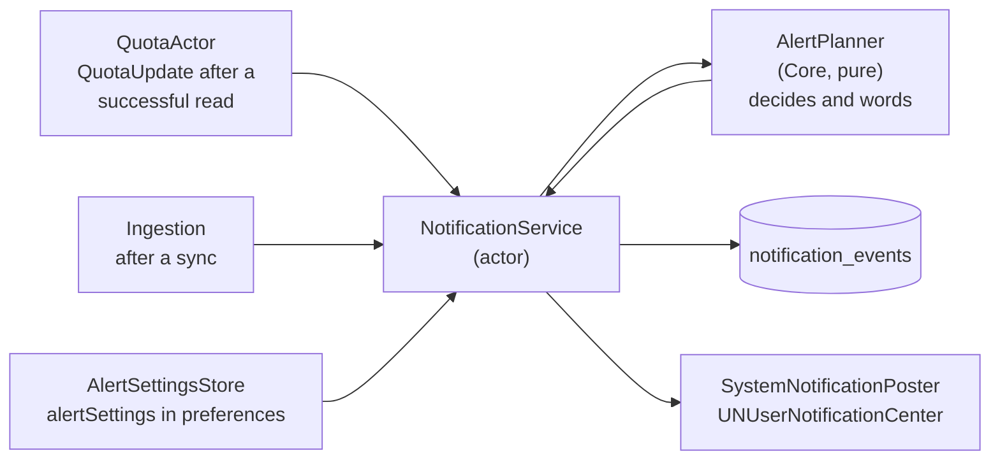

# Notifications

Which alerts Burnline sends, when, how it makes sure each is sent once, and
how it asks for permission.

## The parts



- **`AlertPlanner`** (Core) decides which alerts a reading or a sync calls for
  and writes their words. It is pure: the caller passes in what has already
  fired and records what comes out. That makes every rule testable with an
  injected clock and no notification centre.
- **`NotificationService`** (an actor in Services) keeps the set already fired,
  records every decision, asks for permission when it should, and posts.
- **`SystemNotificationPoster`** reaches the notification centre only when
  used, since a test process has no app bundle to give it.

## Every kind of alert

| Kind (`notification_type`) | When | Default |
|---|---|---|
| `threshold` | A window crosses a chosen percentage | 75% and 90% for every window |
| `limit_reached` | A window reaches 100% | on |
| `available_again` | A window that had reached its limit resets, as a fresh read confirms | on |
| `provider_reset` | The provider reset a window at least 25% used, and no banked reset was spent. Said in place of "available again". | on |
| `burn_rate` | A window at least half used is projected to run out at least 10 minutes before it resets | on |
| `banked_reset_useful` | A window is at 90% or more while a banked reset is held. Said in place of the threshold alert. | on |
| `banked_reset_expiring` | 12 hours before held banked resets expire, one reminder per expiry (Claude's grants end together) | on |
| `daily_spend` | Today's equivalent cost passes a set amount | off until set |
| `weekly_spend` | This week's equivalent cost passes a set amount | off until set |
| `milestone` | Lifetime tokens pass a milestone from the comparison corpus | on |
| Medal (achievement) | A medal is earned | on |

**Thresholds are chosen per provider and kind of window** (5-hour, weekly,
other) from 50, 75, 90 and 95. Plans differ in which windows they have (Codex
Pro and Claude's Ultra plan have no 5-hour window; Claude Max does), so
Settings shows rows only for the kinds a provider has reported
(`ProviderQuotaState.windowKinds`). An empty list turns a window's thresholds
off.

**One read, one alert.** When a single read crosses both 75% and 90%, only the
90% alert is shown; the 75% one is recorded as fired, not shown. The same
happens to a threshold alert that a banked-reset alert speaks for.

**Claude is named for the account.** Claude's quota covers the whole account,
not only Claude Code, so its alerts say so (EC-Q5).

## Only fresh figures alert

- A **failed read decides nothing**. Stale figures never alert (EC-Q3).
- A window whose reset time has passed without a read confirming the reset
  alerts nothing (EC-T6).
- A reset whose cause is still being explained (up to ten minutes; see
  [quota](quota.md#reset-detection)) holds its alerts until it is explained.
- Freshness checks cover reset events and banked-reset reminders as well as
  thresholds.

## Each alert once

Every decided alert is recorded in `notification_events` **whether or not it
was shown**, so a denied permission degrades to silence rather than a backlog.
The key is:

```
(provider, quota key, type, threshold, cycle token)
```

The **cycle token** names what the alert belongs to:

| Alert | Cycle token |
|---|---|
| Quota alerts | The window's cycle token: provider, quota key, window start |
| A quota with no reported window start | One token for the quota, re-armed only by hysteresis |
| Daily spend | `day:YYYY-MM-DD` |
| Weekly spend | `week:YYYY-MM-DD`, the week's first day |
| Banked-reset reminder | `expires:<epoch>` |

**It is never the reset time.** A banked reset moves the reset time, so keying
on it would hold back the alert that should re-arm. Keying on the window
instead means:

- a **scheduled or banked reset re-arms every threshold**, because it starts a
  new cycle;
- a **moved reset time re-arms nothing**, because the cycle is the same.

**Within one window**, a threshold re-arms once usage falls 5 points below it,
so a correction followed by a second climb alerts again. That state is kept in
memory only.

`NotificationService` loads the last 40 days of `notification_events` at
launch; older alerts belong to windows, days and weeks long over and can never
match again.

**Spend checks capture one instant** for both the local day and week ranges
and their keys, so a check that crosses midnight or a daylight-saving change
uses one consistent day.

The system notification's identifier is stable per alert, so a repeat would
replace rather than stack.

## Milestones and medals

- **Milestones** come from the comparison corpus (`milestones`), worded by the
  comparison engine: "Your first 100,000 tokens: …". Each is announced once. On
  a fresh store the first import only sets the starting point, so a history
  imported during onboarding does not announce a billion tokens.
- **Medals.** After a sync, achievements are judged at most once every five
  minutes, since judging reads all of history. Fresh ones are announced: one
  by name, several together. A new store's first awards are its backfill, too
  many and too old, and pass silently, as do late awards for old usage (older
  than three days). Every one is marked announced either way.
- **Clicking a medal notification** opens the Achievements page, which plays
  the medal's arrival. Other notifications only bring the app forward.

## Permission

Burnline **never asks for notification permission on launch** or on its
first frame. It asks in context:

1. **Onboarding**, on its last step, after explaining what the alerts are and
   showing what they look like, and only if the user chooses them.
2. **Send Test** in Settings → Notifications, since the user just pressed it.
3. If neither ever asked, the **first alert there is to show** asks, and is
   shown if allowed.

Once refused, nothing asks again. Reading the current permission never asks.

## Settings

Settings → Notifications edits `AlertSettings`, saved as JSON under the
`alertSettings` preference and handed live to
`NotificationService.update(settings:)`. Every field is optional when read, so
settings saved by an older build keep their choices and take defaults for
anything new.
