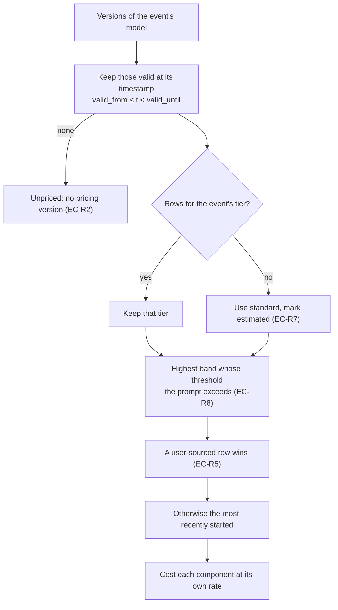
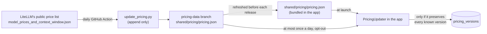

# Pricing

How Burnline turns token counts into equivalent cost, where its prices come
from, and how a price change reaches events that are already stored.

The rules any implementation must follow are in
[the contracts](contracts.md#5-pricing). This page explains them and the macOS
implementation.

## What "cost" means here

Burnline shows **equivalent cost**: what the same requests would cost at the
provider's published API prices, **at the prices in force when each request
happened**. A subscriber is not billed this amount. It is a way to see the
value and the shape of the work, comparable across providers.

Every cost figure carries:

- its **coverage**, the share of events that have a price at all. An unknown
  model never silently lowers a total; it lowers the coverage instead
  (EC-U3);
- its **confidence**, through the versions that priced it.

## Money

All money is `Nanodollars`: US dollars × 10⁹ in an `Int64`.

- Prices enter through `Nanodollars(decimalString:)`, which parses a decimal
  string exactly and refuses anything that would need rounding (more than nine
  fractional digits) or does not fit.
- Costs come out of `Nanodollars.cost(tokens:ratePerMillionTokens:)`, which
  multiplies in 128 bits and rounds half to even. 10⁹ tokens at $15 per
  million is 1.5×10¹⁹ before dividing, past the 64-bit range (EC-R6). A cost
  that still cannot fit throws rather than wrapping.
- There is **no `Double` initialiser**. `ArchitectureTests` rejects any
  floating-point type or literal in `BurnlineCore/Money/`.
- Exports print dollars from nanodollars exactly (`12.345678901`), through
  SQLite's integer arithmetic, never a `Double`.

The comparison engine keeps a private `Double` conversion for ratios between
its own hand-written constants and a figure. It never feeds a cost.

## Selecting a price

`Pricer` (in Core, pure) prices one event against every pricing version of its
model.



- **The prompt**, for choosing a band, is input plus cache reads plus cache
  writes. A band prices **every token** of the event, not only those above its
  threshold, matching how providers bill long prompts.
- **Tiers.** Recorded values map as follows. Absent, `default`, `standard` and
  `auto` are standard. `priority` is priority. Codex's `fast` is OpenAI
  priority processing. Claude Code's `fast` is Anthropic fast mode (`fast`).
  `flex` and `ultrafast` are themselves. Anything else is priced at standard
  and marked estimated.
- **Components.** Input, cache read, cache write (5-minute), cache write
  (1-hour) and output are each costed at their own rate. A cache component with
  no rate of its own falls back: a 1-hour write to the 5-minute write rate, then
  to input. The result is then estimated. If input or output has tokens but no
  rate, the event is left **unpriced** rather than understated.
- **Reasoning is never added.** Both providers count it inside output.
- **Non-models are never priced.** An event with an empty model, an unknown
  model, or a model whose versions have a gap at its time is unpriced, and the
  reason (`UnpricedReason`) is derived when it is read: unknown model, no
  pricing version, or non-model.

## Confidence

| Value | Meaning |
|---|---|
| `exact` | The published price for the time the event happened |
| `reconstructed` | A price assumed for earlier time. The source publishes only today's rates, so the first price known for a model is assumed to have applied since the beginning. |
| `estimated` | A fallback was used: a tier priced at standard, or a cache component at another rate |
| `unknown` | No basis at all |

## Cache savings

What caching saved on one event: its cache reads and writes costed as plain
input, less what they cost at the event's own cache rates.

- Cache writes cost more than input, so an event that only writes saves a
  negative amount. Totals include both.
- **An event whose price has no cache rates of its own is left out** (EC-R3).
  The input-rate fallback that prices it would show no saving where the true
  saving is unknown. Totals state the share of cache tokens they cover.
- Savings are summed per event at each event's own model, tier, band and
  rates, **never as one discount across providers**.
- They are stored on the event (`cache_savings_nanos`) and summed into the
  rollups with the tokens they cover, because compacted history has no pricing
  version left to compute them from.

The dashboard's "Where the tokens went" card shows them as the bill without
caching beside the bill with it.

## Where prices come from



### The manifest

`shared/pricing/pricing.json`:

```json
{
  "schemaVersion": 1,
  "generatedAt": "2026-11-01T04:19:54Z",
  "source": "…",
  "versions": [
    { "provider": "codex", "model": "gpt-5.4", "validFrom": "1970-01-01T00:00:00Z",
      "tier": "flex", "abovePromptTokens": 272000, "source": "litellm",
      "confidence": "reconstructed",
      "perMillion": { "input": "2.5", "cachedInput": "0.25", "output": "11.25" } }
  ]
}
```

- `provider` is a `ProviderKey` raw value. `model` is a canonical name as in
  `model_aliases.json`, or, for a model that file does not list, the name the
  provider writes.
- Rates are **decimal strings** per million tokens, never JSON numbers, so no
  float is parsed on the cost path. The components are `input`, `cachedInput`,
  `cacheWrite`, `cacheWriteOneHour` and `output`.
- `validUntil`, `abovePromptTokens` and any rate may be absent.
- A version's identity is provider, model, tier, band, `validFrom` and source.
- **A manifest is refused whole** if it names an unknown provider or tier, has
  an unparseable or negative rate, an end before its start, a repeated
  identity, or a `schemaVersion` this build does not support.

### The generator

`shared/pricing/tools/update_pricing.py` (standard library only) compares
LiteLLM's current table with the manifest and only ever appends:

- It reads LiteLLM entries under `anthropic` (→ `claude_code`) and `openai`
  (→ `codex`) whose names start with `claude-`, `gpt-` or `codex-` and whose
  mode is chat or responses. Resellers' `provider/model` copies, images, audio
  and embeddings are skipped.
- It produces rows for the standard tier, OpenAI's `priority`, `flex` and
  `ultrafast` tiers, Anthropic's fast mode (LiteLLM's multiplier on every
  standard row), and every `input_cost_per_token_above_<N>k_tokens` band.
- **A tier or band never seen before starts at the Unix epoch.** It is `exact`
  for a model new to the manifest, whose history begins now, and
  `reconstructed` for one already there, whose earlier price is assumed.
  `--seed` marks every new row reconstructed, for a first run.
- **A changed rate starts a new version on the day it was observed**, `exact`.
  The old version is left in place, without an end date. Since selection
  prefers the most recently started row, the new one applies from that day and
  the old one still prices everything before it.
- Existing versions are never edited, removed or reordered.

```sh
python3 shared/pricing/tools/update_pricing.py                 # fetch LiteLLM and append
python3 shared/pricing/tools/update_pricing.py --litellm prices.json --seed
python3 -m unittest -v shared/pricing/tools/test_update_pricing.py
```

**Never edit `pricing.json` by hand.** A hand edit to an existing version is a
rewrite of history, and every app that already has that version will refuse
the next fetched copy.

### The daily job

`.github/workflows/update-pricing.yml` runs at 04:17 UTC every day (and on
demand). It tests the generator, checks out the `pricing-data` branch (or
starts it from the bundled copy on the first run), appends LiteLLM's changes,
and pushes a commit only if something changed. Scheduled workflows run only
from the default branch.

`pricing-data` is a data-only branch, so price updates never wait for an app
release and never touch `main`. The bundled copy in `shared/pricing/` is
refreshed from it before each release.

## In the app

`PricingUpdater` (an actor in Services):

1. **At launch, before the first sync**, applies the bundled manifest and the
   last fetched copy, if any, so new events are priced as they arrive.
2. **At most once a day** fetches
   `https://raw.githubusercontent.com/igharsha7/Burnline-AI-Usage-Tracker/pricing-data/shared/pricing/pricing.json`
   with a plain GET: an ephemeral session, no cookies, no cache, no
   credentials, a 30-second timeout. It carries nothing beyond the URL.
3. **Checks the fetched copy preserves history.** Every version known from the
   bundle and the last fetched copy must be in it, exactly. A copy that edits
   or drops one is refused whole (EC-R9), so a bad or tampered file can add
   prices but never move historical cost.
4. Saves it to `~/Library/Application Support/Burnline/pricing.json`; the
   file's date records when it was fetched.

The fetch is **on by default** and switched off with Settings → Pricing →
"Fetch new prices daily" (`pricingUpdates`), live, with no relaunch. Check
Now fetches at once. Without the fetch, the bundled prices still price all
history.

## When new versions arrive

`PricingRepository.apply` inserts only versions it has not seen, creating any
model a manifest names that the database lacks, and returns the time windows
the new versions affect. Then:

1. The insert trigger queues each new version in `pending_repricing`, in the
   same transaction.
2. `reprice` updates only the events in those windows (EC-R4), walking the
   timestamp index in batches of 5,000, each priced at the rates of its own
   time against the full history. A narrow window, such as a change from
   today, never scans the whole table.
3. The marker is removed only after every batch has committed. A crash
   midway leaves it, and `repricePending` finishes it at the next launch.
   Repricing is idempotent, so a replay is safe.

Events before the compaction boundary are never re-priced: **compacted time
keeps the cost it had**, since its events are gone.

The rollup triggers move totals as events are re-priced, in the same
transactions.

## User prices

A version with `source = "user"` outranks every other source for the time it
covers (EC-R5). The store supports it; Settings has no editor for custom
prices yet.

## Repair

Settings → Data offers **Recalculate Prices**: every stored event is re-priced
from the versioned history, each at the price in force when it happened. It is
safe to run at any time, and is what to do after correcting an alias.
