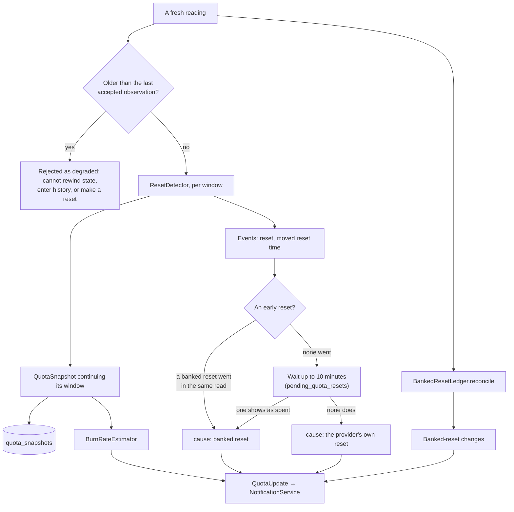

# Quota and limits

How Burnline reads each plan's limits, decides when a window has reset, keeps
track of banked resets, and projects when a window will run out.

**Quota is a separate system from usage history.** It comes from the
providers, never from token counts. A subscription allowance is metered in ways
local token counts cannot reproduce, and Burnline never pretends otherwise.

## Vocabulary

- A **window** is one allowance period: a rolling 5-hour window, a weekly
  window, a model's own weekly window, or a free plan's monthly window. It has
  a percentage used and a reset time. Its **quota key** is stable within a
  provider: `five_hour`, `weekly`, `seven_day_opus`, or `<limit id>.<window>`.
- A window's **cycle token** is provider + quota key + window start. It names
  one cycle of one window.
- A **banked reset** is a consumable that clears a window early. See
  [below](#banked-resets).

## Sources

Each provider has a `FallbackQuotaReader`: its preferred reader first, then a
fallback. If every reader fails, the preferred one's error is the one
reported. An account with no subscription limits (an API-key account) is not
retried on the fallback, since there is nothing to find.

| Provider | Preferred | Fallback |
|---|---|---|
| Codex | `CodexAppServerReader`: `codex app-server`, `account/rateLimits/read` | `CodexRolloutQuotaReader`: the last rate limits written into the newest rollout files |
| Claude | `ClaudeUsageEndpointReader`: one GET to Claude's usage endpoint with Claude Code's login | `ClaudeCodeUsageReader`: Claude Code's `get_usage` control request |

Only the preferred readers see banked resets. A reading from a fallback
carries `bankedResets: nil`, which means "cannot see", not "none", and leaves
what is known untouched.

The details of each source, the login, and how child processes are started and
stopped are in [providers](providers.md).

### Failures

A failed read is a reason, never a crash (`QuotaReadError`). None of the
reasons carries a credential or a response body, so all can be logged.

| Reason | Shown as |
|---|---|
| `notInstalled` | "Codex is not installed." |
| `notSignedIn` | Not signed in, the Keychain read was declined or needs permission again, or reading the login is off |
| `credentialExpired` | "The login has expired. Using the tool again renews it." (EC-Q4) |
| `unreachable` | Offline, timed out, or the service failed (EC-Q3) |
| `rateLimited` | "The provider asked Burnline to check less often." |
| `unsupported` | The account has no subscription limits |
| `malformed` | The answer's shape changed: the provider has likely changed it |

After a failure the last figures stay on screen, marked stale with their age,
with the reader's reason beneath, so an expired login and a dropped connection
read differently.

## When quota is read

`QuotaActor` reads each tracked provider on `QuotaSchedule`. It is
conservative by design: the provider is never hammered.

| Situation | Next read after |
|---|---|
| Idle | 15 minutes |
| In use (usage imported in the last 10 minutes) | 5 minutes |
| A window at 90% or more | 2 minutes |
| On battery or in Low Power Mode | intervals doubled, except near a limit |
| A reset time before the next read | 30 seconds after the reset time, so the reset is confirmed as it happens |
| After a failure | 1 minute, doubling each failure, up to 30 minutes |
| After waking from sleep | at once, after history has synced (EC-T5) |

A read already under way for a provider is never started twice. Only tracked
providers are read, so an untracked tool's login is never touched.

## From a reading to a snapshot



### Reset detection

`ResetDetector` (Core, pure) turns a provider's reading into a snapshot that
continues the window it belongs to, and says when a window has reset. A
window's start is kept stable across reads.

| What the reading shows | Verdict |
|---|---|
| The reset time advanced, and the old window had already ended | A **scheduled** reset |
| The reset time advanced before the old window ended, and usage fell | An **early** reset: a banked reset or the provider's (EC-Q1) |
| The reset time advanced while usage kept rising | The provider **moved the reset time**; nothing re-arms (EC-Q2) |
| The reset time drifted by under 15 minutes | Nothing: providers round and re-derive it |
| Usage fell 20 points or more with the reset time unchanged, or none reported | A **reset**. Providers resetting everyone's usage can leave the reset time alone. |
| Local time passed the reset time, no new reading | Nothing yet: the window shows `resetPending` until a read confirms it (EC-T6) |

**Naming the cause.** `QuotaActor` sees the banked resets in the same read:

- one left the list or was marked spent → a **banked reset**;
- none did → the verdict waits ten minutes, about two reads while in use,
  because a provider's list can lag the usage it resets. A banked reset shown
  as spent in that time still explains it; otherwise it was **the provider's
  own reset**;
- a source that cannot see banked resets → the reset stays **early**,
  unexplained.

Alerts about the reset wait with it. The pending cycle, when it was seen, and
a reference to its last recorded "before" figure are kept in
`pending_quota_resets`, so a restart during the wait loses nothing. Reloading
it raises no event until a fresh reading explains it. A pending explanation is
discarded once that quota has entered a later cycle, keeping the later reset's
own before figure and cause.

**Simultaneous resets** are separate events: each quota is tracked on its own,
with its own notification state (EC-Q7).

### Banked resets

`BankedResetLedger.reconcile` keeps the stored list in step with what the
provider reports. The provider's word decides:

| Provider says | Stored status |
|---|---|
| Still listed (including Codex's `redeeming`) | `held` |
| Marked redeemed or spent | `consumed` |
| Gone, and its expiry has passed | `expired` |
| Gone, expiry not passed | `unknown`, never assumed consumed (EC-Q6) |
| Source cannot see banked resets | nothing changes |

Rows are saved only when new or when their status or expiry changed.

Display and behaviour rules:

- A banked reset is a **count with a target window and an expiry**, never a
  percentage and never added to a used figure.
- It shows its expiry countdown while held. Once the expiry passes without
  the provider confirming, the countdown shows zero rather than assuming.
- Claude's grants hold several resets each and end together. Burnline stores
  one row per reset a grant holds, numbered within it, so a count that falls
  leaves the missing ones to the ledger's rules.
- **Burnline never spends one.** It observes.

### Snapshots and staleness

- A snapshot is written when anything about a window changes, and at least
  hourly when nothing does.
- **A figure older than 30 minutes is stale** (`ProviderQuotaState.staleAfter`)
  even if nothing failed, as after sleep, until the next read replaces it.
  Stale figures are shown with their age ("Updated 18 min ago"), never
  replaced by zero (EC-Q3).
- After a restart, the last recorded figures are shown, marked stale, until a
  read confirms them.
- Every figure is the account's, across every device and app. The interface
  labels it account-wide (EC-Q5).

### Status

`QuotaStatus` from the percentage used, judged when shown, not stored:

| Used | Status |
|---|---|
| under 75% | `healthy` |
| 75% | `warning` |
| 90% | `critical` |
| 100% | `exhausted` |
| past its reset time, unconfirmed | `resetPending` |
| failed, or older than 30 minutes | `stale` |

## Burn rate

`BurnRateEstimator` (Core, pure) runs after each read on the window's recorded
snapshots plus the new figure:

1. **Keep the current window only.** Points before a new window start, or
   before an unexplained fall of more than 2 points, belong to a window that
   ended. A banked reset's 94%-to-0% drop is therefore never averaged across
   (EC-Q1). Smaller falls are provider rounding.
2. **Keep the last hour** of it.
3. **Fit a line by weighted least squares**, each point weighted by age with a
   20-minute half-life, so one burst moves the rate without dominating it.
4. **While that rate is idle** (under 0.1 points an hour), or too short to fit,
   use the window's average since it started instead, once at least a tenth of
   the window has passed. A few minutes in, one burst would read as a runaway.
5. **Extrapolate to 100%** and compare with the reset time. A window with no
   known reset time is projected at most 31 days ahead.

The rate is never negative: usage falling within a window is a correction,
not negative consumption. It needs at least 10 minutes of observations and a
figure under 30 minutes old; otherwise the state says why there is none
(`stale` or `notEnoughData`) rather than forcing a number. The projection is
shown only when the window would run out **before** it resets.

## The Limits page's history

`LimitHistory` builds each window's story from recorded observations only, so
it shows what was seen, never an interpolation between sightings:

- the open window's readings, oldest first;
- up to 12 earlier windows of the same quota, each with its peak;
- what this Mac sent the provider since the window began, read from usage
  (a window waiting for its reset to be confirmed counts nothing after it).

A cycle is told apart by its window start where the source reports one, so a
reset time moved mid-window stays one cycle, ending at the latest reset
reported (EC-Q2). Without a start it is told apart by its reset time.

The Limits page then judges each window (`WindowOutlook`) from its use, how
much of its time has gone and its burn rate: barely touched, comfortably under
pace, right on pace, running ahead, runs out early (and by how much), or
reached. See [the interface](interface.md#limits).

## What reaches notifications

Every successful read hands a `QuotaUpdate` to `NotificationService` before
`refresh` returns: the figures before the read, the new state, and the
confirmed resets, moved reset times and banked-reset changes. **A failed read
hands nothing**, so stale figures never alert. See
[notifications](notifications.md).

## Testing against real accounts

```sh
BURNLINE_REAL_QUOTA=1 swift test --package-path macos/Packages --filter RealQuotaTests
```

Runs every reader against this Mac's accounts and prints the **shape** of each
answer, never its values. It may ask for Keychain access to Claude Code's
login. Run it by hand when a provider's response seems to have changed.
